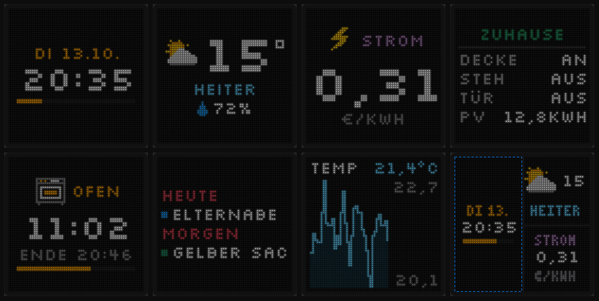

# PixelPanel Studio

**LED-Panel-Dashboard für Home Assistant (ESP32 + HUB75).**
Gestalte Seiten für eine LED-Matrix im Browser – Uhr, Wetter, Werte, Listen, Timer, Kalender, Diagramme –
mit pixelgenauer Live-Vorschau, und spiel sie per ESPHome aufs Panel. *English: [README.md](README.md)*

## Funktionen

- **10 Seitentypen:** Uhr (digital/analog), Wetter, Wert, Entität, Liste, Timer, Laufschrift, Kalender, Verlauf, Stapel (mehrere Inhalte gleichzeitig)
- **Jede Entität aus Home Assistant** – Werte kommen live aufs Panel
- **Pixelgenaue Vorschau** – genau so sieht es auf dem Panel aus
- **Bedingungen** – Seiten nur zeigen, wenn etwas zutrifft (Tür offen, Strom günstig …), geprüft vom Panel selbst
- **Ruhezeit & Abenddimmung** pro Nacht, läuft im Panel auch ohne PC oder HA
- **21 Seitenübergänge**, pro Seite einstellbar, was mit **zu langem Text** passiert (Laufschrift, Abkürzen, Ausblenden)
- **Strombudget** – das Panel rechnet jedes Bild durch und zieht nie mehr, als dein Netzteil liefert
- **Mehrere Panels**, beliebige Anordnung und Drehung, viele fertige Boards (ESP32, ESP32-S3, Matrix Portal S3, Apollo M1, Huidu …)
- **Bebilderte Verkabelungs-Anleitung** passend zu deinem Board
- **Eigene Icons** (zeichnen oder laden), Community-Icons, Umlaute, € und ° auf dem Panel
- **Handy & Tablet** mit Anmeldung, Liste der angemeldeten Geräte, alle geöffneten Browser bleiben synchron
- Oberfläche und Panel-Texte **Deutsch & Englisch**, Hell/Dunkel, „Einfach erklärt“ für Einsteiger

## Voraussetzungen

- Ein **ESP32** (oder ESP32-S3) und ein **HUB75-LED-Panel** mit **5-V**-Netzteil
- **Voller Funktionsumfang nur mit Home Assistant.** Ohne HA läuft das Studio im Demo-Modus mit Beispieldaten.

## Installation

### Weg 1 – Home-Assistant-App (HA OS / Supervised)

1. *Einstellungen → Apps → App-Store → ⋮ → Repositories* → `https://github.com/Bitax/pixelpanel-studio` hinzufügen
2. **PixelPanel Studio** installieren, starten, **In Seitenleiste anzeigen** einschalten
3. Zusätzlich die **ESPHome-App**; dort unter *Konfiguration → Netzwerk* den Port **6052** eintragen

Kein Token, keine extra Anmeldung – die App läuft in der Seitenleiste von Home Assistant.

> **Keine App unter Home Assistant Container (Docker) oder Core** – dort gibt es keine Apps. Nimm die PC-Version.

### Weg 2 – PC-Version (Windows, Mac, Linux)

1. **Python 3.11+** installieren ([python.org](https://www.python.org/downloads/); unter Windows „Add python.exe to PATH“ anhaken)
2. `PixelPanelStudio_3.1.zip` bei den [Releases](https://github.com/Bitax/pixelpanel-studio/releases) laden und entpacken
3. `Start.bat` (Windows) bzw. `sh start.sh` (Mac/Linux) starten – der Browser öffnet http://localhost:8765
4. *Einstellungen → Zugänge & Sicherheit → Home Assistant*: Adresse + langlebiges Zugriffstoken

## Handbuch

Ausführlich mit Bildern: **[docs/de](docs/de/README.md)** · als PDF bei jedem Release.

[Einrichtung](docs/de/01-einrichtung.md) · [Hardware & Verkabelung](docs/de/02-hardware-verkabelung.md) · [Panel & Strom](docs/de/03-panel-strom.md) ·
[Seiten](docs/de/04-seiten.md) · [Bedingungen](docs/de/05-bedingungen.md) · [Ruhezeit](docs/de/06-ruhezeit-abenddimmung.md) ·
[Animation & Zu langer Text](docs/de/07-animation-zu-langer-text.md) · [Handy-Zugriff](docs/de/08-handy-zugriff-geraete.md) ·
[Feedback & Icons](docs/de/09-feedback-icons.md) · [Fehlerhilfe & FAQ](docs/de/10-fehlerhilfe-faq.md)

## Feedback & Icons

Ideen und Fehler: im Studio *Einstellungen → Feedback* oder ein [Issue anlegen](https://github.com/Bitax/pixelpanel-studio/issues/new/choose).
Ein schönes 16 × 16-Icon gemacht? Im Icon-Editor vorschlagen – angenommene Icons erscheinen bei allen unter *Community-Icons*.

## Sicherheit

Standardmäßig nur am eigenen PC erreichbar; der Handy-Zugriff braucht ein Passwort. Siehe [SECURITY.md](SECURITY.md).
Den Ordner `data` nie weitergeben oder hochladen – dort stehen Token, WLAN-Passwort und API-Schlüssel.

## Lizenz

**GNU General Public License v3.0** – siehe [LICENSE](LICENSE). Nutzen, verändern und weitergeben erlaubt; veränderte Versionen
müssen ebenfalls offen unter GPL-3.0 bleiben und den Urheber nennen.
Mitgeliefert: Silkscreen-Schrift (SIL OFL 1.1, `LICENSE-Silkscreen-OFL.txt`), QR-Code-Generator von Kazuhiko Arase (MIT).
Community-Icons: CC0 1.0.

© Bitax
