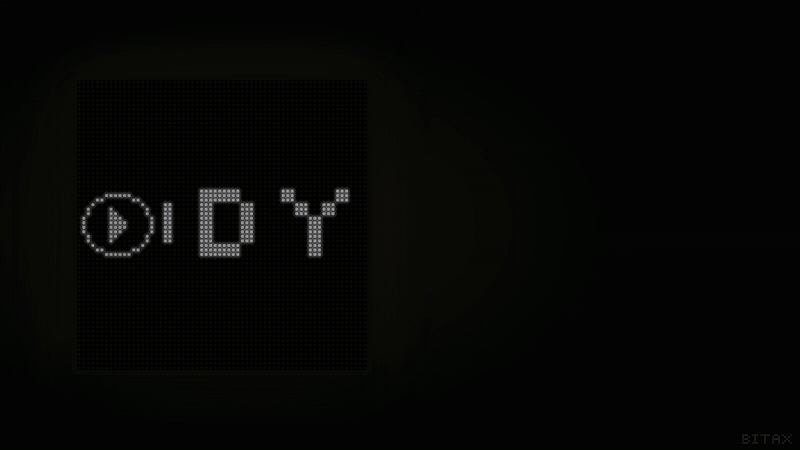
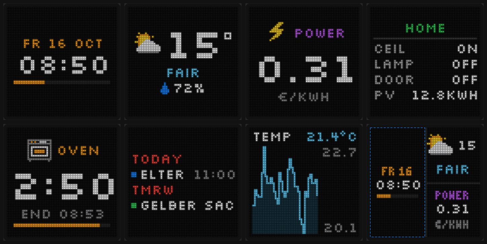
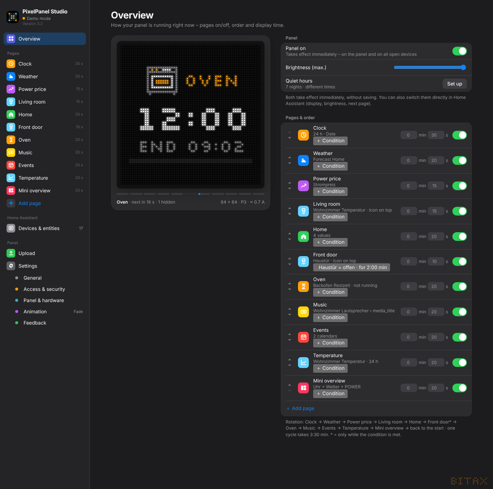

# PixelPanel Studio

**LED panel dashboard for Home Assistant (ESP32 + HUB75).**
Design pages for an LED matrix in your browser – clock, weather, values, lists, timers, calendar, charts –
see a pixel-exact live preview and push it to the panel via ESPHome. *Deutsch: [README.de.md](README.de.md)*

## Features

- **10 page types:** Clock (digital/analog), Weather, Value, Entity, List, Timer, Scrolling text, Calendar, Chart, Stack (several contents at once)
- **Any Home Assistant entity** – values update live on the panel
- **Pixel-exact preview** – what you see is exactly what the panel shows
- **Conditions** – show pages only when something is true (door open, price low …), checked by the panel itself
- **Quiet hours & evening dimming** per night, running on the panel even without PC or HA
- **21 page transitions**, per-page handling of **text that is too long** (scroll, shorten, hide)
- **Power budget** – the panel calculates every frame and never draws more than your power supply delivers
- **Multiple panels**, any arrangement and rotation, many ready-made boards (ESP32, ESP32-S3, Matrix Portal S3, Apollo M1, Huidu …)
- **Illustrated wiring guide** for your exact board
- **Animated icons** – the bulb glows when the light is on, the washing machine drum turns while it runs, the timer border flashes when done
- **Custom icons** (draw or import), community icons, umlauts, € and ° on the panel
- **Phone & tablet** access with sign-in, signed-in device list, all open browsers stay in sync
- **German & English** interface and panel texts, light/dark mode, “explained simply” mode for beginners

## Requirements

- An **ESP32** (or ESP32-S3) and a **HUB75 LED panel** with a **5 V** power supply
- **Home Assistant** for full functionality. Without it the Studio runs in demo mode with sample data.

## Installation

### Option 1 – Home Assistant app (HA OS / Supervised)

1. *Settings → Apps → App store → ⋮ → Repositories* → add `https://github.com/Bitax/pixelpanel-studio`
2. Install **PixelPanel Studio**, start it, enable **Show in sidebar**
3. You also need the **ESPHome Device Builder** app – the Studio puts the configuration there and you click **Install**

No token, no extra login – the app runs in the Home Assistant sidebar.

> **No app on Home Assistant Container (Docker) or Core** – Home Assistant has no apps there. Use the PC version.

### Option 2 – PC version (Windows, Mac, Linux)

1. Install **Python 3.11+** ([python.org](https://www.python.org/downloads/); on Windows tick “Add python.exe to PATH”)
2. Download `PixelPanelStudio_3.2.zip` from the [releases](https://github.com/Bitax/pixelpanel-studio/releases) and unpack it
3. Start `Start.bat` (Windows) or `sh start.sh` (Mac/Linux) – the browser opens http://localhost:8765
4. *Settings → Access & security → Home Assistant*: address + long-lived access token

## Manual

Full manual with screenshots: **[docs/en](docs/en/README.md)** · PDF with every release.

[Setup](docs/en/01-setup.md) · [Hardware & wiring](docs/en/02-hardware-wiring.md) · [Panel & power](docs/en/03-panel-power.md) ·
[Pages](docs/en/04-pages.md) · [Conditions](docs/en/05-conditions.md) · [Quiet hours](docs/en/06-quiet-hours.md) ·
[Animation & text too long](docs/en/07-animation-text-too-long.md) · [Phone access](docs/en/08-phone-access-devices.md) ·
[Feedback & icons](docs/en/09-feedback-icons.md) · [Troubleshooting & FAQ](docs/en/10-troubleshooting-faq.md)

## Feedback & icons

Ideas and bugs: *Settings → Feedback* in the Studio or [open an issue](https://github.com/Bitax/pixelpanel-studio/issues/new/choose).
Made a nice 16 × 16 icon? Suggest it from the icon editor – accepted icons appear for everyone under *Community icons*.

## Security

The Studio only listens on the local PC by default; phone access needs a password. See [SECURITY.md](SECURITY.md).
Never share or upload the `data` folder – it contains your token, Wi-Fi password and API key.

## License

**GNU General Public License v3.0** – see [LICENSE](LICENSE). You may use, modify and share it; modified versions must stay
open source under GPL-3.0 and keep the author credit.
Included: Silkscreen font (SIL OFL 1.1, `LICENSE-Silkscreen-OFL.txt`), QR code generator by Kazuhiko Arase (MIT).
Community icons: CC0 1.0.

© Bitax
