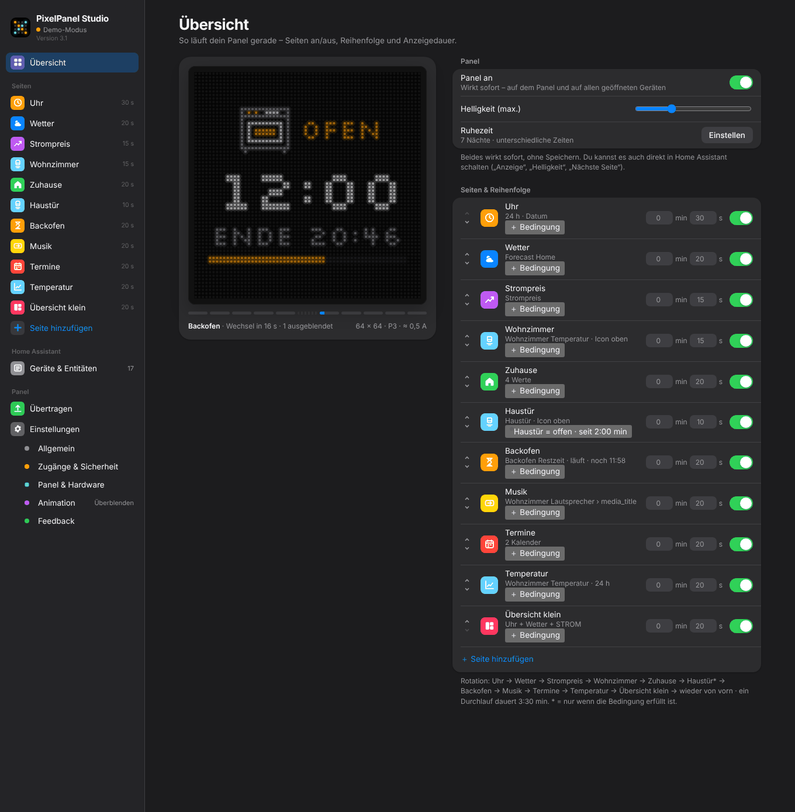
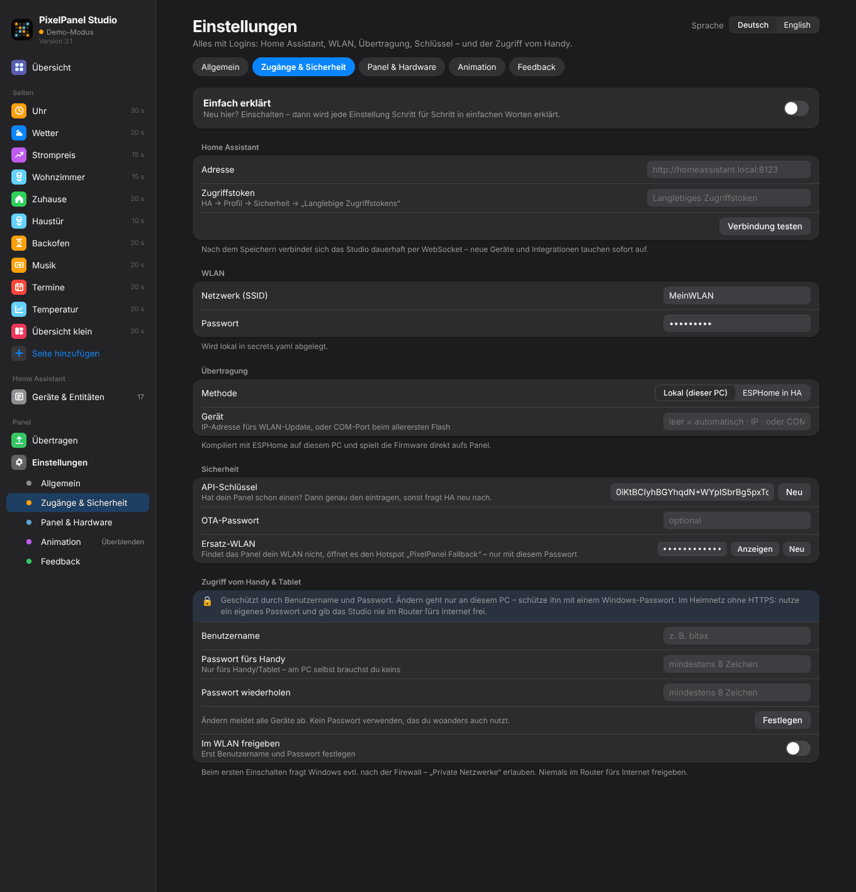
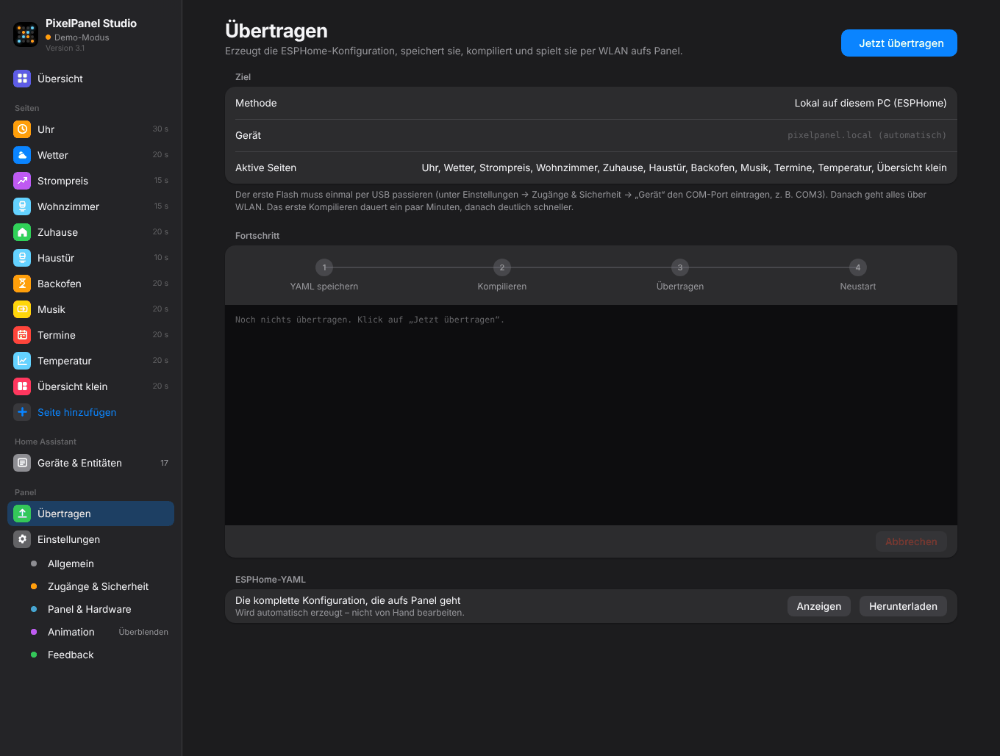
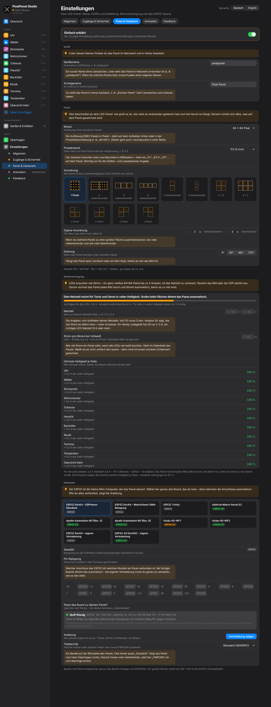

# 1. Einrichtung

PixelPanel Studio ist eine Oberfläche im Browser, mit der du Seiten für ein LED-Panel
(HUB75) an einem ESP32 gestaltest. Das Studio erzeugt daraus eine fertige ESPHome-Firmware
und spielt sie aufs Panel. Die Werte (Temperatur, Strompreis, Timer, Kalender …) kommen live
aus Home Assistant.

> **Voller Funktionsumfang nur mit Home Assistant.** Ohne Home Assistant läuft das Studio
> im **Demo-Modus** mit Beispieldaten – gut zum Ausprobieren, aber das Panel bekommt dann
> keine Werte, keine Timer und keine Live-Änderungen.

## Welche Version passt zu mir?

| Du hast … | Nimm … |
|---|---|
| Home Assistant **OS** oder **Supervised** (z. B. Home Assistant Green/Yellow, Raspberry Pi mit HA OS, VM) | die **Home-Assistant-App** – läuft in der Seitenleiste von HA, ohne Token |
| Home Assistant **Container** (Docker) oder **Core** | die **PC-Version** – dort gibt es keine Apps |
| noch kein Home Assistant | die **PC-Version** im Demo-Modus zum Ausprobieren |

Beide Versionen sind gleich – nur Anmeldung und Übertragung unterscheiden sich.

## A) PC-Version (Windows, Mac, Linux)

1. **Python 3.11 oder neuer** installieren ([python.org](https://www.python.org/downloads/)).
   Unter Windows beim Setup **„Add python.exe to PATH“** anhaken.
2. Bei den [Releases](https://github.com/Bitax/pixelpanel-studio/releases) die Datei
   `PixelPanelStudio_3.1.zip` herunterladen und entpacken.
3. Starten:
   - **Windows:** `Start.bat` doppelklicken
   - **Mac/Linux:** Terminal öffnen, in den Ordner wechseln (`cd` + Ordner ins Fenster ziehen) und `sh start.sh` eingeben
4. Beim ersten Start wird alles Nötige installiert (inkl. ESPHome) – das dauert ein paar Minuten.
5. Der Browser öffnet sich auf **http://localhost:8765**.

Das Fenster mit den Meldungen offen lassen – schließt du es, ist das Studio beendet.

### Mit Home Assistant verbinden

*Einstellungen → Zugänge & Sicherheit → Home Assistant*

- **Adresse**, z. B. `http://homeassistant.local:8123`
- **Zugriffstoken**: In Home Assistant unten links auf dein Profil → *Sicherheit* →
  *Langlebige Zugriffstokens* → *Token erstellen*. Den Text kopieren und einfügen.
- **Verbindung testen**, dann speichern.

Danach hält das Studio eine Verbindung offen. Neue Geräte und Entitäten tauchen sofort unter
*Geräte & Entitäten* und in allen Auswahllisten auf.

## B) Home-Assistant-App

1. In Home Assistant: **Einstellungen → Apps → App-Store** öffnen.
2. Oben rechts **⋮ → Repositories** und diese Adresse hinzufügen:
   `https://github.com/Bitax/pixelpanel-studio`
3. **PixelPanel Studio** in der Liste wählen → **Installieren**.
4. **Starten** und **„In Seitenleiste anzeigen“** einschalten.
5. **PixelPanel** in der Seitenleiste öffnen.

Die App meldet sich selbst bei Home Assistant an – du brauchst keine Adresse und kein Token.
Einstellungen liegen im Speicher der App und sind in jedem HA-Backup enthalten.
Updates erscheinen wie bei jeder anderen App unter *Einstellungen → Apps*.

**Voraussetzung für die Übertragung:** die **ESPHome-App** (ESPHome Device Builder).
Dort unter *Konfiguration → Netzwerk* den Port **6052** eintragen und die ESPHome-App neu starten.

## Erste Schritte

1. *Einstellungen → Panel & Hardware*: **Board** und **Panel-Größe** wählen ([Kapitel 2](02-hardware-verkabelung.md), [Kapitel 3](03-panel-strom.md)).
2. *Einstellungen → Zugänge & Sicherheit → WLAN*: WLAN-Name und Passwort eintragen.
3. *Einstellungen → Allgemein*: Zeitzone, 24-/12-Stunden-Format, Sprache prüfen.
4. Seiten anlegen ([Kapitel 4](04-seiten.md)). Schnellster Weg: *Geräte & Entitäten* →
   bei einer Entität **„Als Seite“**.
5. Unten erscheint die Leiste **„Übernehmen & aufs Panel“** → klicken.

## Übertragen

Unter *Zugänge & Sicherheit → Übertragung* gibt es zwei Wege:

| | Lokal (dieser PC) | ESPHome in HA |
|---|---|---|
| Kompiliert auf | deinem PC | dem Home-Assistant-Rechner |
| Voraussetzung | WLAN-Daten in den Einstellungen | ESPHome-App, Port 6052 freigegeben |
| Gerät im ESPHome-Dashboard sichtbar | nein | ja |
| In der Home-Assistant-App | – | **immer dieser Weg** |

**Allererste Übertragung:** Ein neuer ESP32 muss einmal per **USB-Kabel** bespielt werden.

- *PC-Version, lokal:* ESP32 per USB anstecken, unter *Übertragung → Gerät* den Anschluss
  eintragen (Windows z. B. `COM3`, siehe Geräte-Manager → Anschlüsse; Mac z. B.
  `/dev/cu.usbserial-…`), **Jetzt übertragen**. Danach das Feld wieder leeren.
- *ESPHome in HA:* in der ESPHome-App beim Gerät **Installieren → „Plug into this computer“**.

Ab dann geht jedes Update per WLAN. Das erste Kompilieren dauert einige Minuten, danach geht es deutlich schneller.

Beim ersten Mal meldet Home Assistant ein **neues Gerät** – auf *Konfigurieren* klicken. Fragt HA
nach dem **Verschlüsselungsschlüssel**: Er steht unter *Zugänge & Sicherheit → Sicherheit → API-Schlüssel*.

**Läuft dein Panel schon mit ESPHome?** Dann den bisherigen API-Schlüssel aus deiner alten YAML
unter *Sicherheit* eintragen – sonst fragt HA neu danach.

## Live übernehmen oder neu übertragen?

Manche Änderungen gehen **ohne neues Kompilieren** direkt aufs Panel: Anzeigedauer, Seite an/aus,
Schwellenwerte von Bedingungen, Helligkeit, Panel an/aus. Die Leiste zeigt dann **„Live übernehmen“**.
Neue Seiten, andere Entitäten, Farben, Layout oder neue Bedingungsarten brauchen
**„Übernehmen & aufs Panel“** (neues Übertragen).

In Home Assistant bekommt das Panel zusätzlich: Schalter **Anzeige**, Regler **Helligkeit**,
Taste **Nächste Seite**, Schalter **Ruhezeit** und die Live-Werte unter *Konfiguration* (z. B. „Uhr Dauer“).
Die Namen richten sich nach der **Sprache auf dem Panel** – mit englischen Panel-Texten heißen sie „Display“, „Brightness“ usw.

## Sprache & Aussehen

- *Einstellungen → Allgemein → Sprache*: Oberfläche **Deutsch/English** (pro Browser gemerkt) und getrennt
  davon die **Sprache auf dem Panel** (Wochentage, HEUTE/TODAY, FERTIG/DONE, AN/AUS, Wetter).
- *Erscheinungsbild*: Automatisch, Hell oder Dunkel.
- **Einfach erklärt** (oben in den Einstellungen und auf jeder Seite): zeigt zu jeder Einstellung eine
  ausführliche Erklärung für Einsteiger.

