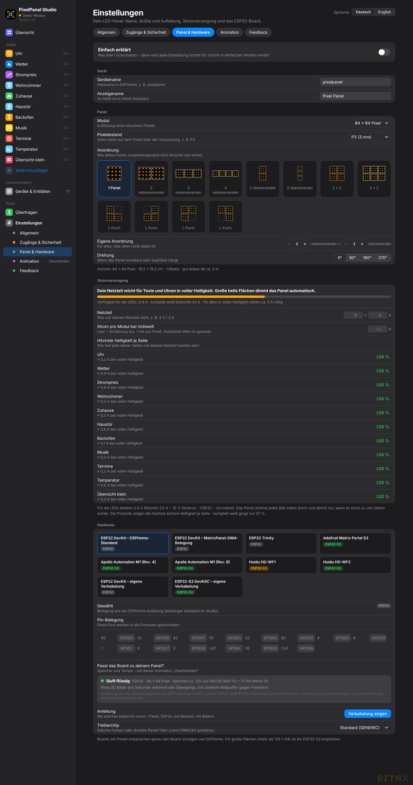

# 3. Panel & Strom

*Einstellungen → Panel & Hardware*

## Gerät

- **Gerätename** – Hostname in ESPHome, z. B. `pixelpanel` (nur Kleinbuchstaben, Ziffern, Bindestrich)
- **Anzeigename** – so heißt das Panel in Home Assistant

## Panel

- **Modul** – Auflösung eines einzelnen Panels: 64 × 64, 64 × 32, 128 × 64 oder 32 × 32
- **Pixelabstand** – steht meist auf dem Panel oder der Verpackung (P2, P2,5, P3, P4 …).
  Daraus berechnet das Studio die echte Größe und ab welchem Abstand man es gut lesen kann.
- **Anordnung** – per Klick auf ein Bild: 1 Panel, 2–4 nebeneinander, 2–3 übereinander, 2 × 2, 3 × 2,
  vier L-Formen – oder als **eigene Anordnung** (Spalten × Zeilen; einzelne Felder lassen sich wegklicken).
- **Drehung** – 0°, 90°, 180°, 270°, wenn das Panel hochkant oder kopfüber hängt.

Unter der Gruppe steht die Gesamtgröße, z. B. *64 × 64 Pixel · 19,2 × 19,2 cm · 1 Modul · gut lesbar ab ca. 3 m*.

### Mehrere Panels – die Kette

Mehrere Panels werden hintereinander verkettet: ESP32 → IN von Panel 1, OUT von Panel 1 → IN von Panel 2 usw.
In der **Verkabelungs-Anleitung** zeigen Zahlen die Reihenfolge der Kette ab dem ESP.
Unter *Hardware* gibt es dazu das **Ketten-Layout** – „Automatisch“ sucht das passende.
Ist das Bild nach dem Übertragen vertauscht oder gespiegelt, ein anderes Ketten-Layout probieren.

Mehr als 128 × 64 Pixel an einem klassischen ESP32: Die Farbtiefe wird automatisch reduziert;
ein ESP32-S3 ist dafür besser.

## Stromversorgung

- **Netzteil** – was auf deinem Netzteil steht, z. B. 5 V / 3 A
- **Strom pro Modul bei Vollweiß** – leer lassen = Schätzung (ca. 1 mA pro Pixel). Mit dem Wert aus dem Datenblatt wird es genauer.

Der Balken oben zeigt, wie viel Strom für die LEDs übrig bleibt (Netzteil − 10 % Reserve − ESP32 − Grundlast)
und was ein komplett weißes Bild bräuchte. Balken, Farbe (grün / gelb / rot) und Satz ändern sich sofort,
während du die Werte eintippst.

**Das Panel rechnet jedes Bild selbst durch** und regelt die Helligkeit nur dann herunter, wenn das Bild
sonst mehr ziehen würde, als das Netzteil sicher liefert. Text-Seiten bleiben meist bei voller Helligkeit,
große helle Flächen werden leicht gedimmt. Die Liste **„Höchste Helligkeit je Seite“** zeigt das für jede deiner Seiten.
In der Vorschau steht der geschätzte Strom, bei Dimmung zusätzlich ⚡.

Der Netzteil-Wert ist live änderbar – auch in Home Assistant als „Netzteil Strom“.

## Helligkeit

Die **Helligkeit (max.)** stellst du auf der *Übersicht* ein. Sie wirkt sofort – auf dem Panel und in allen
geöffneten Browsern – und lässt sich auch in Home Assistant regeln. Die Netzteil-Grenze gilt zusätzlich.
