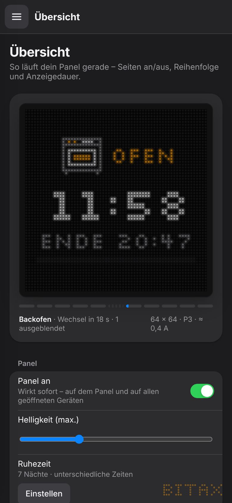
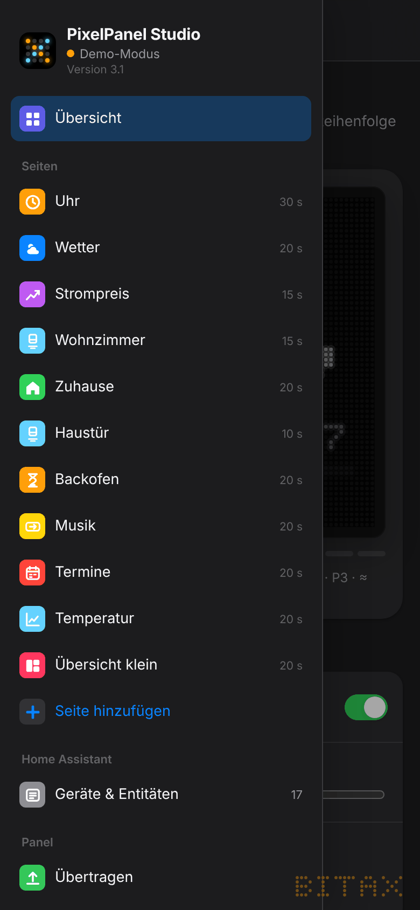
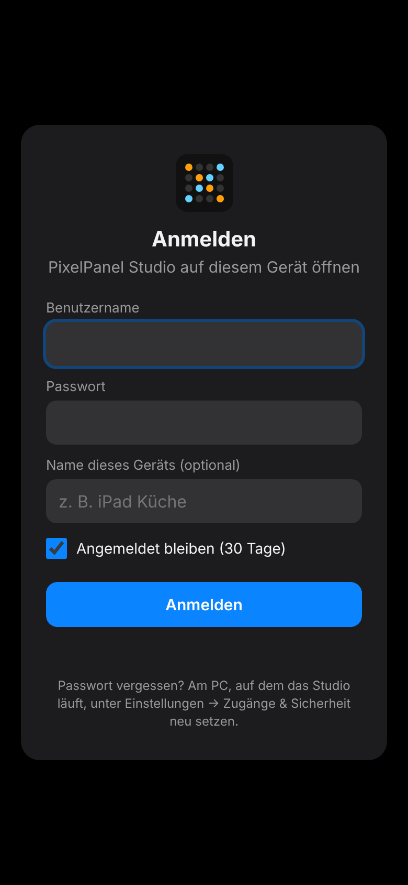

# 8. Handy-Zugriff & Geräte

Die Oberfläche passt sich an jede Bildschirmgröße an: Auf Tablet und Handy wird die Seitenleiste zum Menü
(☰ oben links), Einstellungen stehen untereinander, Dialoge kommen von unten.

## Home-Assistant-App

In der App ist nichts einzurichten: Öffne Home Assistant am Handy (App oder Browser) und tippe in der
Seitenleiste auf **PixelPanel**. Die Anmeldung übernimmt Home Assistant.

## PC-Version im WLAN freigeben

Standardmäßig ist das Studio nur auf dem PC selbst erreichbar. Für Handy und Tablet:

1. Am PC: *Einstellungen → Zugänge & Sicherheit → Zugriff vom Handy & Tablet*
2. **Benutzername** und **Passwort** (mindestens 8 Zeichen) festlegen.
3. **„Im WLAN freigeben“** einschalten. Das Studio startet kurz neu und zeigt die Adresse
   (z. B. `http://192.168.178.20:8765`) und einen **QR-Code**.
4. Am Handy die Adresse öffnen oder den QR-Code mit der Kamera scannen und anmelden.

Tipp: Im Browser **„Zum Home-Bildschirm“** – dann wirkt es wie eine App.

Windows fragt beim ersten Freigeben eventuell nach der Firewall: **„Private Netzwerke“** erlauben.

### Anmelden

- **Angemeldet bleiben (30 Tage)** – standardmäßig an. Ohne Haken endet die Anmeldung, wenn der Browser
  geschlossen wird, spätestens nach 12 Stunden.
- **Name dieses Geräts (optional)** – z. B. „iPad Küche“. Ohne Namen erkennt das Studio Gerät und Browser selbst
  (z. B. „iPhone · Safari“).

### Angemeldete Geräte

*Zugänge & Sicherheit → Angemeldete Geräte* zeigt alle Handys und Tablets: Name, zuletzt aktiv, wie lange noch angemeldet.
Mit **Abmelden** beendest du die Anmeldung eines einzelnen Geräts, mit **Alle abmelden** alle auf einmal.

### Regeln

- Am PC selbst brauchst du **nie** ein Passwort.
- Benutzername, Passwort und Freigabe lassen sich nur am PC ändern. Passwort vergessen? Am PC einfach neu setzen –
  danach müssen sich alle Geräte neu anmelden.
- Nach 5 Fehlversuchen gibt es eine wachsende Wartezeit.
- **Niemals** im Router fürs Internet freigeben (Portweiterleitung). Im Heimnetz läuft die Verbindung ohne HTTPS –
  verwende deshalb ein eigenes Passwort, das du nirgends sonst nutzt.

## Mehrere Geräte gleichzeitig

Alle geöffneten Studios bleiben synchron:

- **Helligkeit** und **Panel an** auf der Übersicht wirken sofort – auf dem Panel und auf allen Geräten, ohne Speichern.
- Speichert ein Gerät, übernehmen die anderen die Änderung automatisch.
- Hast du auf einem Gerät gerade selbst ungespeicherte Änderungen, erscheint oben ein Hinweis:
  **Neu laden** oder **Meine Änderungen behalten**.
