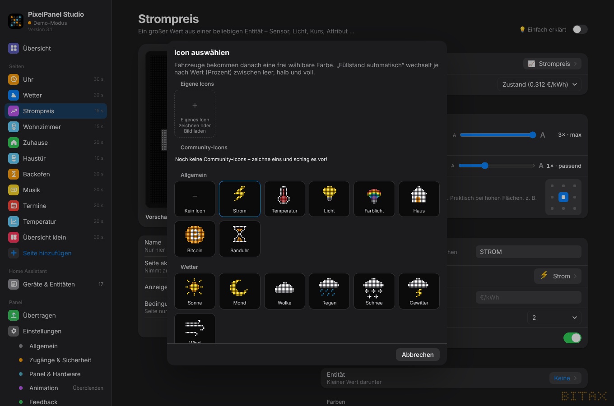
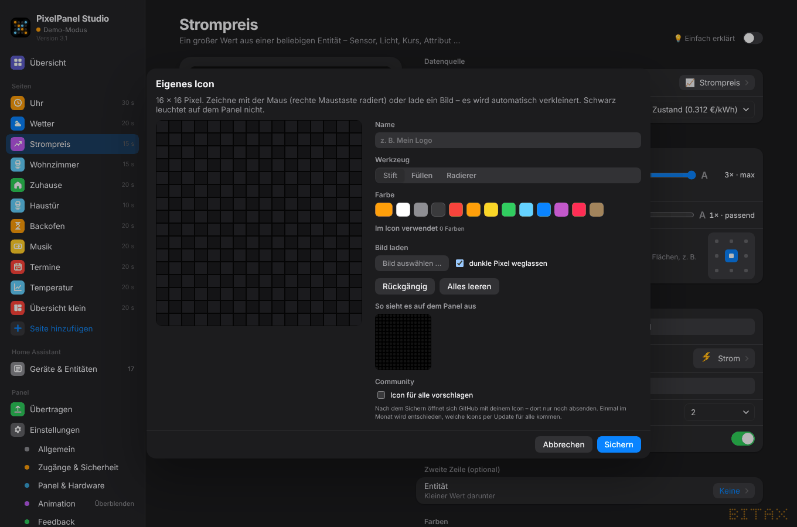
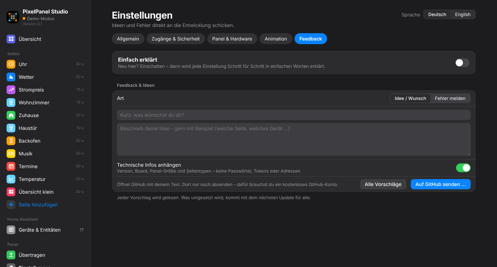

# 9. Feedback & Icons

## Icons

Wert-, Entität-, Timer- und Laufschrift-Seiten haben eine **Icon-Auswahl** mit Vorschaubildern:

- **Allgemein** – Blitz, Thermometer, Glühbirne, Haus, Bitcoin, Timer …
- **Wetter** – Sonne, Mond, Wolke, Regen, Schnee, Gewitter, Wind
- **Haushalt** – Backofen, Waschmaschine, Spülmaschine, 3D-Drucker, Füllstand leer/halb/voll und
  **Füllstand automatisch** (wechselt nach Prozentwert)
- **Medien & Streaming** – Livestream, Video, Gaming, Kamera
- **Fahrzeuge** – Limousine, Kombi, Kleinwagen, SUV, Kastenwagen, Sportwagen, Cabrio, Pick-up – mit frei wählbarer **Lackfarbe**
- **Community-Icons** – Icons, die andere Nutzer vorgeschlagen haben (siehe unten)

### Eigene Icons

In der Icon-Auswahl ganz oben **＋ Eigenes Icon**:

- 16 × 16 Pixel selbst zeichnen: Stift, Füllen, Radierer, Farben
- oder ein **Bild laden** (PNG/JPG/SVG) – wird automatisch verkleinert, Transparenz bleibt erhalten,
  dunkle Pixel können weggelassen werden

Eigene Icons werden mit deiner Konfiguration gespeichert und landen 1:1 auf dem Panel.
Markenlogos sind nicht eingebaut – für den privaten Gebrauch kannst du sie hier selbst laden.

### Icon für alle vorschlagen

Im Icon-Editor **„Icon für alle vorschlagen“** anhaken und bestätigen, dass du es **selbst gemacht** hast
(keine Logos, nichts Abgezeichnetes) und es unter **CC0** (frei für alle) freigibst. Es öffnet sich ein
vorausgefülltes GitHub-Formular, das du dort nur noch absendest (kostenloses GitHub-Konto nötig).

Ein Bot prüft den Vorschlag automatisch (Größe, Farben, Format). Wird er angenommen, erscheint das Icon bei
allen unter **Community-Icons** – ein Klick, und es gehört dir (funktioniert danach auch offline).

## Feedback

*Einstellungen → Feedback*

- **Idee** oder **Fehler** wählen, beschreiben, **„Auf GitHub senden …“**.
- Es öffnet sich ein vorausgefülltes GitHub-Formular – dort absenden.
- **Technische Infos** (Version, Board, Panel-Größe) hängst du nur an, wenn du willst. Passwörter, Tokens und
  Schlüssel werden **nie** mitgeschickt.

Das Studio selbst schickt nichts ins Internet – es öffnet nur GitHub in deinem Browser.
