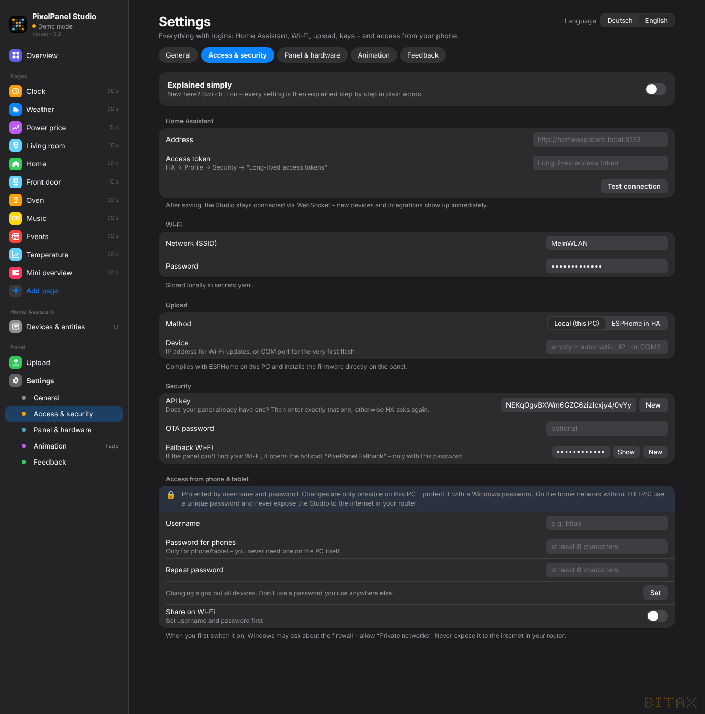
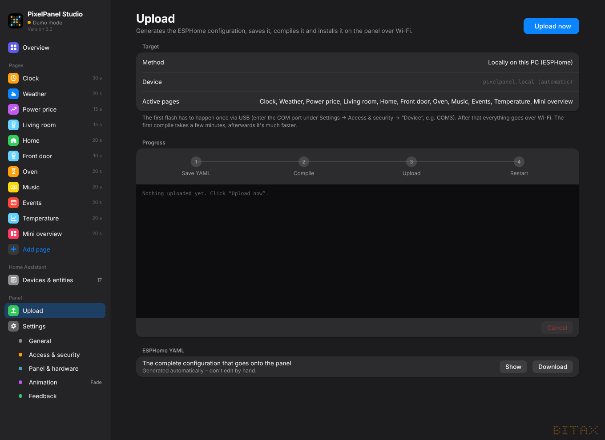
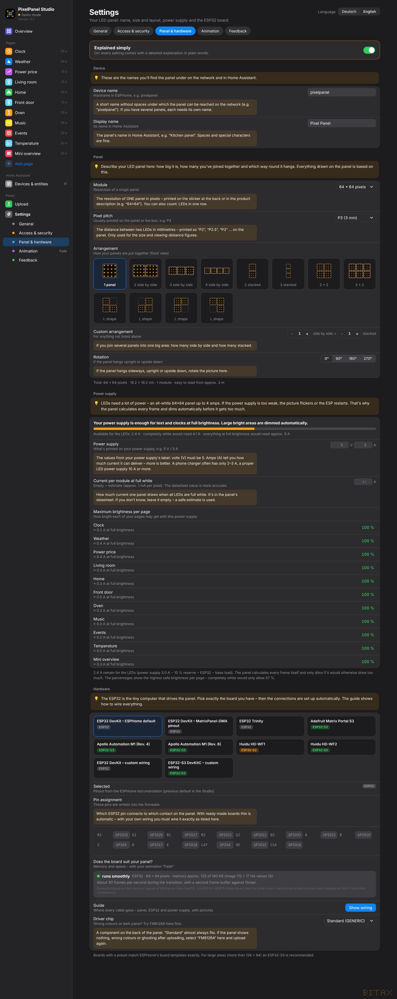

# 1. Setup

PixelPanel Studio is a browser interface for designing pages for an LED panel (HUB75) driven by an ESP32.
The Studio turns them into a ready-made ESPHome firmware and uploads it to the panel. The values
(temperature, electricity price, timers, calendar …) come live from Home Assistant.

> **Full functionality only with Home Assistant.** Without Home Assistant the Studio runs in **demo mode**
> with sample data – fine for trying it out, but the panel then gets no values, no timers and no live changes.

## Which version is right for me?

| You have … | Use … |
|---|---|
| Home Assistant **OS** or **Supervised** (e.g. Home Assistant Green/Yellow, Raspberry Pi with HA OS, VM) | the **Home Assistant app** – runs in the HA sidebar, no token needed |
| Home Assistant **Container** (Docker) or **Core** | the **PC version** – there are no apps there |
| no Home Assistant yet | the **PC version** in demo mode to try it out |

Both versions are the same – only sign-in and upload differ.

## A) PC version (Windows, Mac, Linux)

1. Install **Python 3.11 or newer** ([python.org](https://www.python.org/downloads/)).
   On Windows tick **“Add python.exe to PATH”** during setup.
2. Download `PixelPanelStudio_3.2.zip` from the [releases](https://github.com/Bitax/pixelpanel-studio/releases) and unpack it.
3. Start it:
   - **Windows:** double-click `Start.bat`
   - **Mac/Linux:** open a terminal, change into the folder (`cd` + drag the folder into the window) and type `sh start.sh`
4. On the first start everything needed is installed (incl. ESPHome) – this takes a few minutes.
5. Your browser opens **http://localhost:8765**.

Keep the window with the messages open – closing it stops the Studio.

### Connect to Home Assistant

*Settings → Access & security → Home Assistant*

- **Address**, e.g. `http://homeassistant.local:8123`
- **Access token**: in Home Assistant click your profile (bottom left) → *Security* →
  *Long-lived access tokens* → *Create token*. Copy and paste the text.
- **Test connection**, then save.

The Studio then keeps a live connection. New devices and entities show up immediately under
*Devices & entities* and in every picker.

## B) Home Assistant app

1. In Home Assistant open **Settings → Apps → App store**.
2. Top right **⋮ → Repositories** and add:
   `https://github.com/Bitax/pixelpanel-studio`
3. Pick **PixelPanel Studio** → **Install**.
4. **Start** it and enable **“Show in sidebar”**.
5. Open **PixelPanel** in the sidebar.

The app signs in to Home Assistant by itself – no address or token needed.
Settings are kept in the app's storage and included in every HA backup.
Updates appear like for any other app under *Settings → Apps*.

**Needed for uploading:** the **ESPHome app** (ESPHome Device Builder). In it, enter port **6052**
under *Configuration → Network* and restart the ESPHome app.

## First steps

1. *Settings → Panel & hardware*: choose **board** and **panel size** ([chapter 2](02-hardware-wiring.md), [chapter 3](03-panel-power.md)).
2. *Settings → Access & security → Wi-Fi*: enter Wi-Fi name and password.
3. *Settings → General*: check time zone, 24/12-hour format and language.
4. Create pages ([chapter 4](04-pages.md)). Fastest way: *Devices & entities* → **“As page”** on any entity.
5. The bar **“Apply & upload to panel”** appears at the bottom → click it.

## Uploading

*Access & security → Upload* offers two methods:

| | Local (this PC) | ESPHome in HA |
|---|---|---|
| Compiles on | your PC | the Home Assistant machine |
| Needs | Wi-Fi details in the settings | ESPHome app, port 6052 open |
| Device shows up in the ESPHome dashboard | no | yes |
| In the Home Assistant app | – | **always this method** |

**Very first upload:** a new ESP32 has to be flashed once by **USB cable**.

- *PC version, local:* plug the ESP32 in by USB, enter the port under *Upload → Device*
  (Windows e.g. `COM3`, see Device Manager → Ports; Mac e.g. `/dev/cu.usbserial-…`), **Upload now**.
  Afterwards clear the field again.
- *ESPHome in HA:* in the ESPHome app on the device **Install → “Plug into this computer”**.

From then on every update goes over Wi-Fi. The first compile takes several minutes, later ones are much faster.

The first time, Home Assistant reports a **new device** – click *Configure*. If HA asks for the
**encryption key**: it is under *Access & security → Security → API key*.

**Is your panel already running ESPHome?** Enter the existing API key from your old YAML under *Security* –
otherwise HA asks for it again.

## Apply live or upload again?

Some changes go to the panel **without recompiling**: display time, page on/off, condition thresholds,
brightness, panel on/off. The bar then says **“Apply live”**. New pages, other entities, colours, layout or new
kinds of conditions need **“Apply & upload to panel”** (a new upload).

In Home Assistant the panel also gets: switch **Display**, slider **Brightness**, button **Next page**,
switch **Quiet hours** and the live values under *Configuration* (e.g. “Clock duration”). The names follow the
**language on the panel** – with German panel texts they are German (“Anzeige”, “Helligkeit” …).

## Language & appearance

- *Settings → General → Language*: interface **Deutsch/English** (remembered per browser) and, separately,
  the **language on the panel** (weekdays, TODAY, DONE, ON/OFF, weather).
- *Appearance*: Automatic, Light or Dark.
- **Explained simply** (top of the settings and every page): shows a detailed beginner-friendly explanation for every setting.

