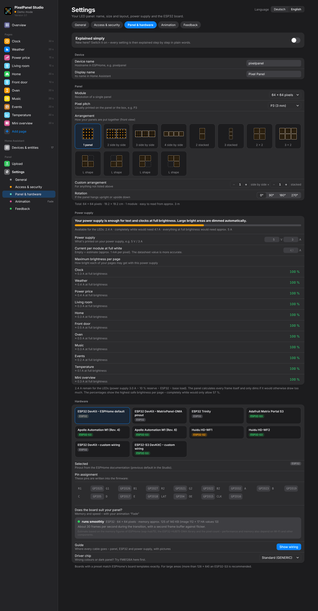

# 3. Panel & power

*Settings → Panel & hardware*

## Device

- **Device name** – hostname in ESPHome, e.g. `pixelpanel` (lower case, digits, hyphen only)
- **Display name** – the panel's name in Home Assistant

## Panel

- **Module** – resolution of one panel: 64 × 64, 64 × 32, 128 × 64 or 32 × 32
- **Pixel pitch** – usually printed on the panel or box (P2, P2.5, P3, P4 …). The Studio uses it for the real size
  and the distance from which it reads well.
- **Arrangement** – click a picture: 1 panel, 2–4 side by side, 2–3 stacked, 2 × 2, 3 × 2, four L shapes –
  or a **custom arrangement** (columns × rows; single positions can be clicked away).
- **Rotation** – 0°, 90°, 180°, 270° if the panel hangs upright or upside down.

Below the group you see the total, e.g. *64 × 64 pixels · 19.2 × 19.2 cm · 1 module · readable from approx. 3 m*.

### Several panels – the chain

Panels are chained: ESP32 → IN of panel 1, OUT of panel 1 → IN of panel 2 and so on.
In the **wiring guide** numbers show the order of the chain from the ESP. Under *Hardware* there is the
**chain layout** – “Automatic” finds the right one. If the picture is swapped or mirrored after uploading, try another chain layout.

More than 128 × 64 pixels on a classic ESP32: colour depth is reduced automatically; an ESP32-S3 is better for that.

## Power supply

- **Power supply** – what your power supply says, e.g. 5 V / 3 A
- **Current per module at full white** – empty = estimate (approx. 1 mA per pixel). The datasheet value is more accurate.

The bar at the top shows how much current is left for the LEDs (supply − 10 % reserve − ESP32 − idle load)
and what a completely white image would need.

**The panel calculates every frame itself** and only lowers the brightness if the image would otherwise draw more
than the power supply can safely deliver. Text pages usually stay at full brightness, large bright areas get dimmed slightly.
The list **“Maximum brightness per page”** shows this for each of your pages. The preview shows the estimated current, and ⚡ when dimming.

The power supply value can be changed live – also in Home Assistant as “Power supply current”.

## Brightness

Set **Brightness (max.)** on the *Overview*. It takes effect immediately – on the panel and in every open browser –
and can also be controlled from Home Assistant. The power supply limit applies on top.
