# 4. Pages

The panel shows your pages one after another like a slideshow. Up to **16 pages**, each with on/off,
order and display time. Every page can use **any entity from Home Assistant**.

**New page:** **＋ Add page** in the sidebar and pick a type – or *Devices & entities* → **“As page”** on an entity.

## What every page has

On the left is the **preview** – pixel-exact as on the panel. Below it:

| Setting | Meaning |
|---|---|
| **Name** | only shown in the Studio |
| **Page active** | off = kept, but not shown |
| **Display time** | minutes + seconds (at least 5 s) |
| **Condition** | only show the page if … – see [chapter 5](05-conditions.md) |
| **Delete page** | removes the page |

On the **Overview** you change order (arrows), time and on/off of all pages at a glance.

### Size & placement (almost every page)

- **Text size** – one slider: far right **max** (as big as fits), to the left smaller in quarter steps
  (1×, 1.25×, 1.5× …), far left the **mini font** (3 × 5 pixels). Secondary lines such as the date or “CLOUDY”
  adapt themselves: without room, only that line gets smaller (down to mini) and then uses a short form.
- **Icon size** – separate slider when the page has an icon.
- **Placement** – where the content sits in its area: top/middle/bottom, left/centre/right. Handy for tall areas.

Sliders that would change nothing on your area are hidden.

### Colours

**Main colour** (the big value) and **accent colour** (title, date, bars).

### Text too long

Only appears when something really doesn't fit – see [chapter 7](07-animation-text-too-long.md).

### Font

The pixel font knows **Ä Ö Ü, € and °** – “21.4 °C” and “0.31 €/kWh” show correctly.
Emojis and rare characters are left out. Panel text is upper case.
Numbers follow the language on the panel: English “1,234.5”, German “1.234,5”.

---

## Clock

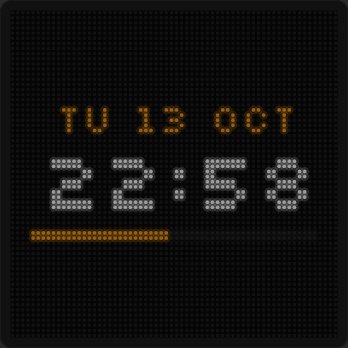

| Setting | Meaning |
|---|---|
| **Clock** | *Digital* (digits, date, seconds bar) or *Analog* (dial with hands) |
| **Show date** | weekday and date (digital) / below the dial (analog) |
| **Show seconds** | 20:31:05 instead of 20:31 |
| **Seconds bar** | thin bar filling up every minute |
| **Second hand** *(analog)* | thin hand in the accent colour |
| **Ring** *(analog)* | subtle circle around the dial |

The time comes from Home Assistant; if HA is unreachable the panel gets it from the internet (SNTP).
Time zone and 24/12-hour format under *Settings → General*.

## Weather

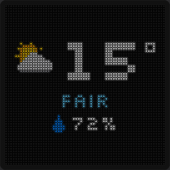

| Setting | Meaning |
|---|---|
| **Entity** | a `weather.…` entity (condition + temperature + humidity) |
| **Show humidity** | drop + percent below the weather |

Symbol (sun, clouds, rain, snow, thunderstorm, wind …) and text (“FAIR”, “RAIN” …) come from the condition.

## Value

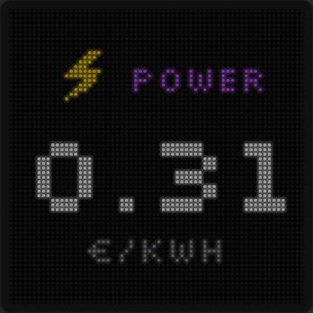

One big value – e.g. electricity price, solar power, a price ticker, room temperature.

| Setting | Meaning |
|---|---|
| **Entity** | any entity with a number (text works too) |
| **Displayed value** | the state or an attribute of the entity |
| **Title on the panel** | short word above the value, e.g. POWER |
| **Icon** | small picture next to the title ([chapter 9](09-feedback-icons.md)) |
| **Unit** | empty = unit from Home Assistant |
| **Decimal places** | Automatic, 0–3 |
| **Thousands separators** | 1,234 instead of 1234 |
| **Second line** | a second entity small below, optionally **coloured as trend** (green rising / red falling) |

No number? Then the state is shown as text (on/off → ON/OFF).

## Entity

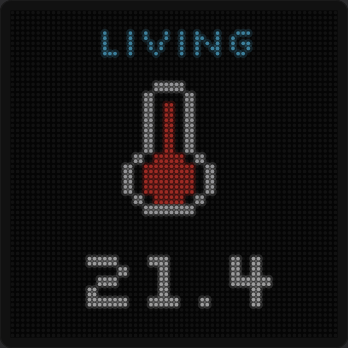

Exactly one entity, big, with an icon above or below.

| Setting | Meaning |
|---|---|
| **Entity / Displayed value** | as for *Value* |
| **Icon** and **Position** | icon on top or at the bottom |
| **Title (optional)**, **Unit**, **Decimal places** | as for *Value* |

Example water tank: entity = fill level in %, icon = **fill level automatic** – the icon shows empty, half or full depending on the percentage.

## List

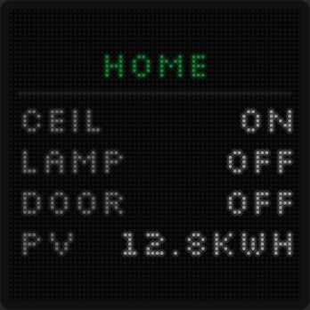

Several entities below each other: a short label on the left, the value on the right.

| Setting | Meaning |
|---|---|
| **Title** | heading, e.g. HOME |
| **Entries** | label + entity per line, **＋ Add entity** |

As many entries fit as the area allows – on large areas in several columns. The Studio tells you how many fit right now.
Smaller text = more room. On/off becomes ON/OFF.

## Timer

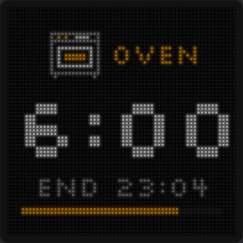

Remaining time of the oven, washing machine, dryer or a timer helper. The page appears by itself as soon as the
timer runs, shows the remaining time, “END 12:45” and a progress bar, afterwards “DONE” for a few minutes – and disappears again.

| Setting | Meaning |
|---|---|
| **Entity** | remaining time, end time or timer helper |
| **Value type** | *Remaining* (number or “1:05:30” – the panel counts down itself to the second), *End time* (timestamp, e.g. “program end” of Home Connect/Miele), *HA timer* (`timer.…`, incl. pause) |
| **Unit of the number** | seconds, minutes or hours (plain numbers only) |
| **Status** | how the panel sees the timer right now |
| **Example in the preview** | shows a running sample timer to adjust the look – not uploaded |
| **Only while the timer runs** | otherwise the page is hidden and doesn't disturb the rotation (own timer pages only, not in a stack) |
| **Show immediately** | jumps straight to this page when the timer starts |
| **Show “DONE”** | no, 1, 2, 5, 10 or 30 min after it ends |
| **Show only this timer** | while it runs, all other pages pause |
| **Title, icon** | e.g. OVEN with the oven icon |
| **Show end time** | “END 12:45” below the remaining time |
| **Progress bar** | fills from start to end |

**When several timers are running** (with “Show only this timer”): show **only the shortest** or **alternating** (every 5–60 s).

Tip: if a device reports a remaining time even when idle, add a condition (e.g. program state = run).

## Scrolling text

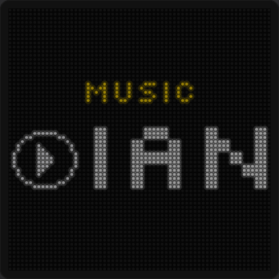

A text runs from right to left.

| Setting | Meaning |
|---|---|
| **Source** | *Fixed text* or *From Home Assistant* |
| **Text** | your own text (up to 200 characters) |
| **Entity / Displayed value** | e.g. media player with `media_title` or `media_artist`, an `input_text` helper, a sensor |
| **Prefix (optional)** | text before the value, e.g. “♪ ” |
| **Always scroll** | off = short texts stand still |
| **Speed** | Slow, Normal, Fast |
| **Run** | *With pause* (stops briefly at the start) or *Endless* (runs without stopping like a news ticker, with a dot between runs) |
| **Title, icon** | optional |

## Calendar

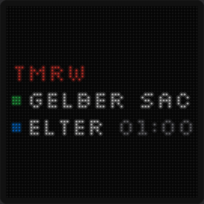

The next events from your calendars.

| Setting | Meaning |
|---|---|
| **Display** | *List* (like your phone: TODAY, TMRW, then e.g. “TH 15 OCT”, below the events with a dot in the calendar colour and the time) or *Large* (few events big – “TODAY 2:30”, “NOW”, “TO 20 OCT”; long titles scroll) |
| **Events from** | *Calendars* (up to 4 calendars, the next event of each) or *Helper sensor (list)* (up to 12 events from several calendars) |
| **Calendar** | calendar + colour, **＋ Add calendar** |
| **Events to show** | at most this many – what doesn't fit is left out |
| **Title on the panel** | optional |
| **Hide** | don't show events containing these words, e.g. “Day off, Birthday” |
| **Colours** | event titles; accent for heading and date |

Duplicate events (same title on the same day) appear only once; multi-day events once with “TO …”.
All-day events have no time.

### Setting up the helper sensor

A calendar in Home Assistant only exposes **the next** event by itself. For a real list:

1. *Events from* → **Helper sensor (list)** → **Guide & YAML …**
2. Pick calendars – they are added to the YAML automatically.
3. **Copy YAML**, open `configuration.yaml` in Home Assistant (e.g. with the “File editor” app) and paste the text
   at the end. If `template:` already exists there, only paste the part from `- triggers:` below it.
4. Restart Home Assistant (or *Developer tools → YAML → Reload template entities*).
5. In the Studio choose the sensor **“PixelPanel Termine”**.

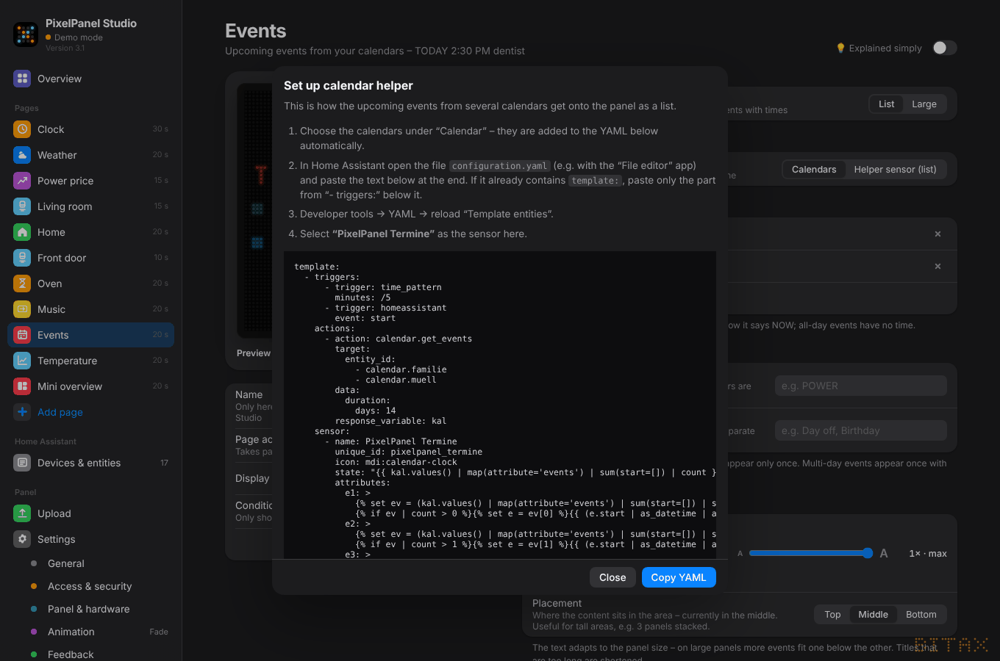

## Chart

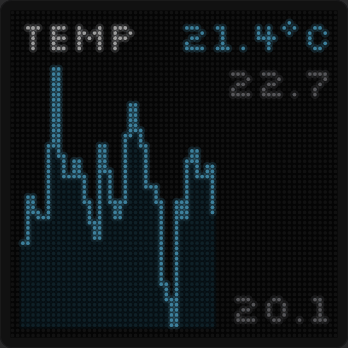

A line or bar chart.

| Setting | Meaning |
|---|---|
| **Entity** | a number, e.g. temperature, consumption, electricity price |
| **Values** | *Panel records* (the panel stores the history itself, also across restarts) or *List from attribute* (a ready-made series, e.g. price forecast from Tibber, Nordpool, EPEX …) |
| **Period** | 6 h, 24 h, 4 days, 7 days – 48 points, each the average |
| **Attribute with list / Key** | for *list*: the attribute (often “today”, “forecast”, “prices”) and – if needed – which number is meant (“value”, “price” …) |
| **Type** | line or bars |
| **Current value** | the latest value top right |
| **Min / Max** | highest and lowest value at the right of the chart |
| **Title, unit, decimal places, colours** | as for *Value* |

After uploading, the panel starts recording; the preview in the Studio already shows the history from Home Assistant.

## Stack

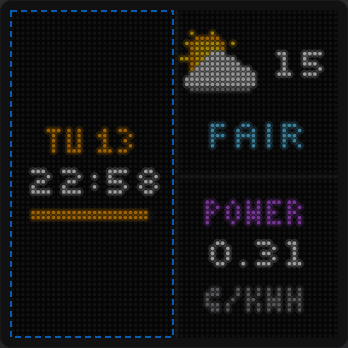

Several contents on the panel at once.

1. Choose a **layout**: 2/3/4 side by side, 2/3 stacked, 2 × 2, big left + 2 right, 2 left + big right,
   big top + 2 bottom, 2 top + big bottom; with several panels also “one field per panel”.
   A stack needs fields of at least 32 × 32 pixels.
2. The **field tabs** (Field 1, Field 2 …) – the selected field is outlined in blue in the preview.
3. **Content of field …**: Clock, Weather, Value, Entity, List, Timer, Scrolling text, Calendar or Chart –
   or “Copy settings from …” an existing page.
4. Below: the settings of this field – exactly like the page type, with its own text size and its own *Text too long*.
5. **Dividers**: thin line between the fields.

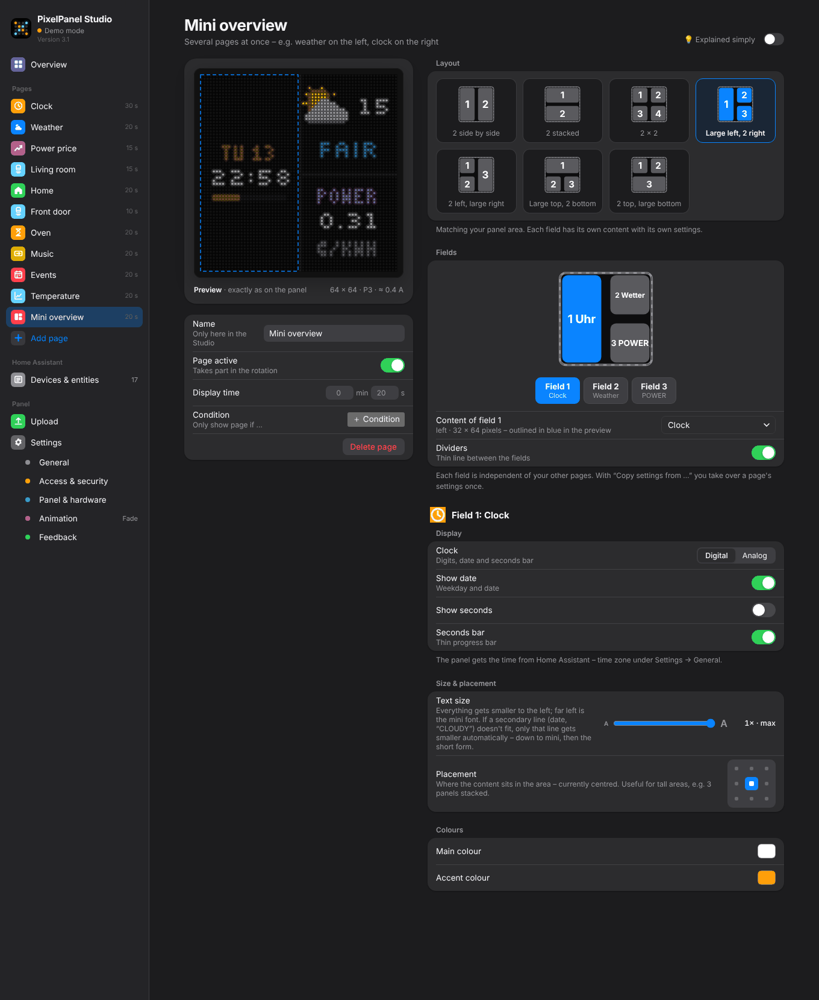
