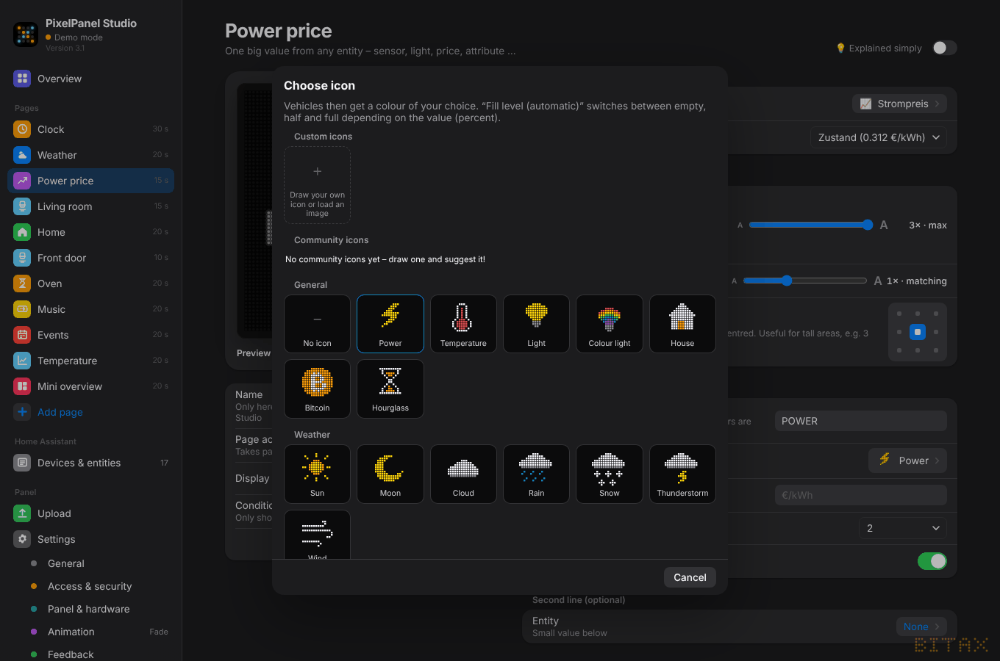
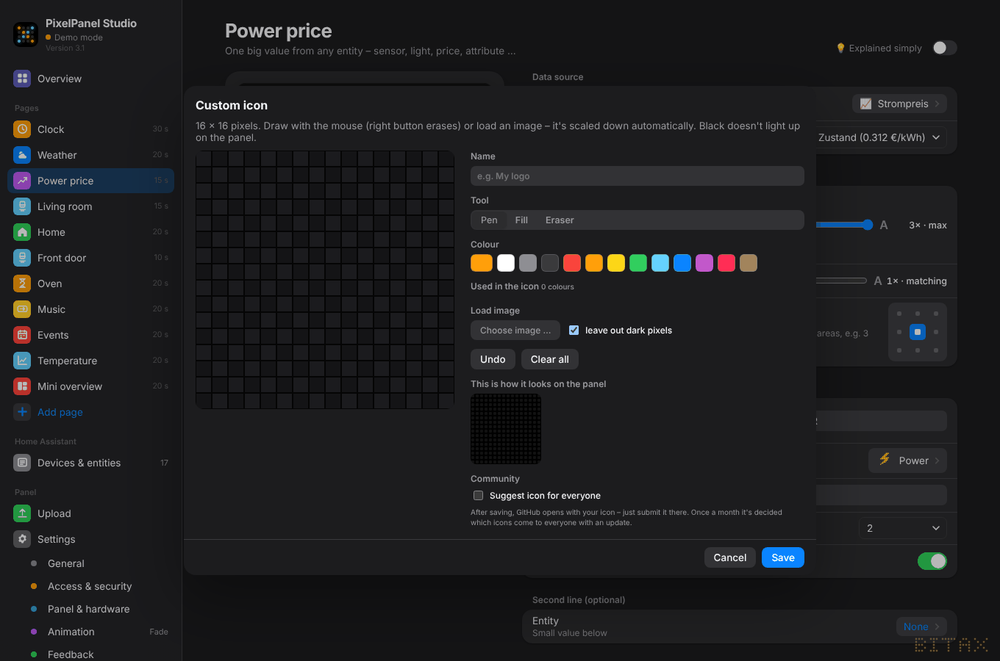
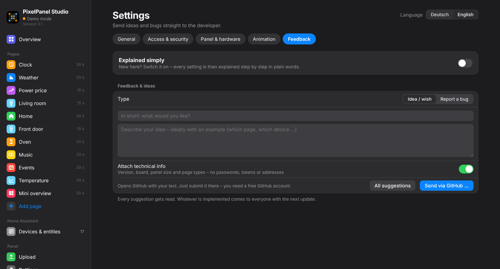

# 9. Feedback & icons

## Icons

Value, Entity, Timer and Scrolling text pages have an **icon picker** with previews:

- **General** – bolt, thermometer, bulb, house, bitcoin, timer …
- **Weather** – sun, moon, cloud, rain, snow, thunderstorm, wind
- **Household** – oven, washing machine, dishwasher, 3D printer, fill level empty/half/full and
  **fill level (automatic)** (changes with the percentage)
- **Media & streaming** – livestream, video, gaming, camera
- **Vehicles** – saloon, estate, small car, SUV, van, sports car, convertible, pick-up – with a freely chosen **paint colour**
- **Community icons** – icons suggested by other users (see below)

### Custom icons

At the top of the icon picker: **＋ Custom icon**

- Draw 16 × 16 pixels yourself: pen, fill, eraser, colours
- or **load a picture** (PNG/JPG/SVG) – scaled down automatically, transparency kept, dark pixels can be dropped

Custom icons are saved with your configuration and end up 1:1 on the panel.
Brand logos are not built in – for private use you can load them here yourself.

### Suggest an icon for everyone

In the icon editor tick **“Suggest icon for everyone”** and confirm that you **made it yourself**
(no logos, nothing traced) and release it under **CC0** (free for everyone). A pre-filled GitHub form opens –
just submit it there (free GitHub account needed).

A bot checks the suggestion automatically (size, colours, format). Once accepted, the icon appears for everyone under
**Community icons** – one click and it's yours (works offline afterwards).

## Feedback

*Settings → Feedback*

- Choose **idea** or **bug**, describe it, **“Send via GitHub …”**.
- A pre-filled GitHub form opens – submit it there.
- **Technical info** (version, board, panel size) is only attached if you want. Passwords, tokens and keys are **never** included.

The Studio itself sends nothing to the internet – it only opens GitHub in your browser.
