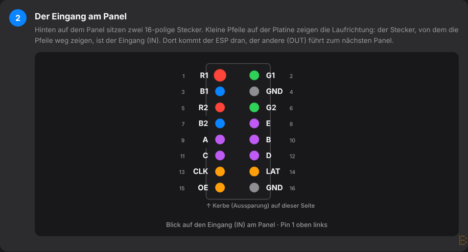
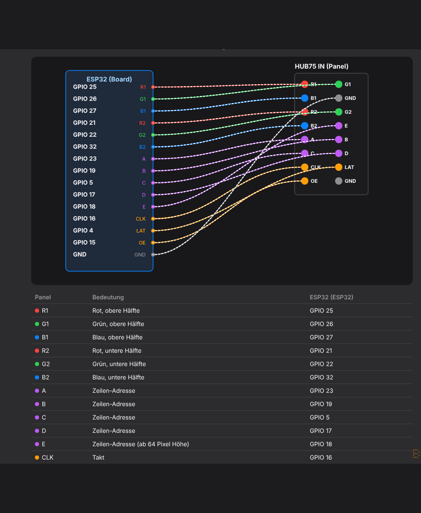
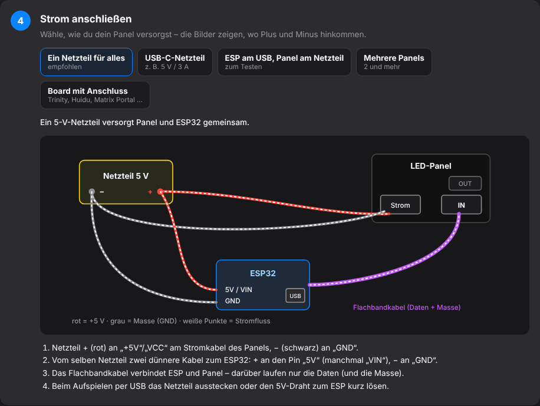
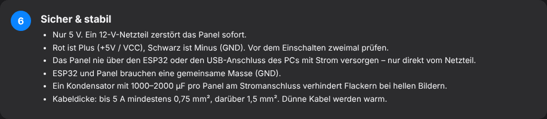

# 2. Hardware & Verkabelung

## Was du brauchst

- **LED-Panel mit HUB75-Anschluss** (z. B. 64 × 64 Pixel, P2,5 oder P3) mit Flachbandkabel und Stromkabel
- **ESP32** – ein normales ESP32-DevKit reicht für ein bis zwei Panels; für große Flächen (mehr als 128 × 64 Pixel) ist ein **ESP32-S3** besser
- **Netzteil 5 V** – mindestens 2 A, für volle Helligkeit bei weißen Bildern ca. 4–5 A pro 64×64-Panel. **Niemals 12 V oder 24 V!**
- **USB-Datenkabel** für das allererste Aufspielen (manche Ladekabel können keine Daten)
- Für ein DevKit: ca. 15 Steckkabel Buchse–Buchse oder eine HUB75-Adapterplatine
- Optional: Kondensator 1000–2000 µF / ab 10 V pro Panel am Stromanschluss (gegen Flackern)

## Board wählen

*Einstellungen → Panel & Hardware → Hardware*

| **Board** | **Chip** | **Hinweis** |
|---|---|---|
| ESP32 DevKit – ESPHome-Standard | ESP32 | Belegung wie im ESPHome-Beispiel (Standard) |
| ESP32 DevKit – MatrixPanel-DMA-Belegung | ESP32 | Belegung der bekannten DMA-Bibliothek |
| ESP32 Trinity | ESP32 | fertige Platine, steckt direkt am Panel |
| Adafruit Matrix Portal S3 | ESP32-S3 | fertige Platine |
| Apollo Automation M1 (Rev. 4 / Rev. 6) | ESP32-S3 | fertige Platine |
| Huidu HD-WF1 / HD-WF2 | ESP32-S2 / - S3 | günstige Controller-Karten |
| ESP32 DevKit / ESP32-S3 DevKitC – eigene Verkabelung | ESP32 / -S3 | Pins frei eintragbar |

Die fertigen Boards nutzen die Board-Vorlagen von ESPHome – Pins und Chip werden automatisch richtig gesetzt. Bei *eigener Verkabelung* trägst du jeden Pin selbst ein.

**Passt das Board zu deinem Panel?** Darunter schätzt das Studio Speicher und Tempo (grün = läuft flüssig, gelb = knapp, rot = zu viel) – inklusive aller Home-Assistant-Werte und deiner Animation.

**Treiberchip:** Fast immer passt *Standard*. Bleibt das Panel dunkel, zeigt falsche Farben oder Geisterbilder, hier **FM6126A** wählen und erneut übertragen.

## Verkabelung Schritt für Schritt

Unter *Panel & Hardware → Hardware → Verkabelung zeigen*** gibt es eine bebilderte Anleitung passend zu deinem Board. Die wichtigsten Bilder:

### Der Eingang am Panel

Hinten auf dem Panel sitzen zwei 16-polige Stecker. Kleine Pfeile zeigen die Laufrichtung: Der Stecker, von dem die Pfeile weg zeigen, ist der **Eingang (IN)**. Dort kommt der ESP32 dran, der andere (OUT) führt zum nächsten Panel.

{w=499}

### ESP32 mit dem Panel verbinden

Jede Leitung vom ESP32 zum gleichnamigen Kontakt am Stecker. Tipp: Das mitgelieferte Flachbandkabel in den Panel-Eingang stecken und die Steckkabel in die andere Seite des Flachbandkabels – so verbiegst du nichts am Panel.

{w=466}

Standard-Belegung (ESP32 DevKit, ESPHome-Standard):

| **Panel** | **Bedeutung** | **ESP32** |
|---|---|---|
| R1 / G1 / B1 | Rot/Grün/Blau obere Hälfte | GPIO 25 / 26 / 27 |
| R2 / G2 / B2 | Rot/Grün/Blau untere Hälfte | GPIO 21 / 22 / 32 |
| A / B / C / D | Zeilen-Adresse | GPIO 23 / 19 / 5 / 17 |
| E | Zeilen-Adresse (ab 64 Pixel Höhe) | GPIO 18 |
| CLK / LAT / OE | Takt / Übernehmen / Ein-Aus | GPIO 16 / 4 / 15 |
| GND | Masse | GND |

### Strom anschließen

{w=499}

Die Anleitung zeigt alle Varianten: ein Netzteil für alles (empfohlen), USB-C-Netzteil, ESP am USB + Panel am Netzteil, mehrere Panels, Boards mit eigenem Anschluss.

### Sicher & stabil

- **Nur 5 V.** Ein 12-V-Netzteil zerstört das Panel sofort.
- Rot ist Plus (+5 V / VCC), Schwarz ist Minus (GND) – vor dem Einschalten zweimal prüfen.
- Das Panel **nie** über den ESP32 oder den USB-Anschluss des PCs mit Strom versorgen – nur direkt vom Netzteil.
- ESP32 und Panel brauchen eine **gemeinsame Masse** (GND).
- Kabeldicke: bis 5 A mindestens 0,75 mm², darüber 1,5 mm².
- Erst alles verkabeln, dann Strom einschalten. Nichts umstecken, solange Strom anliegt.

{w=499}
