# 4. Seiten

Das Panel zeigt deine Seiten nacheinander wie eine Diashow. Bis zu **16 Seiten**, jede mit An/Aus, Reihenfolge und Anzeigedauer. Jede Seite kann **jede Entität aus Home Assistant** nutzen.

**Neue Seite:** in der Seitenleiste ＋ **Seite hinzufügen** und einen Typ wählen – oder unter *Geräte & Entitäten* bei einer Entität **„Als Seite“**.

## Was jede Seite hat

Links steht die **Vorschau** – pixelgenau so, wie es auf dem Panel aussieht. Darunter:

| **Einstellung** | **Bedeutung** |
|---|---|
| **Name** | Nur im Studio sichtbar |
| **Seite aktiv** | Aus = bleibt gespeichert, wird aber nicht gezeigt |
| **Anzeigedauer** | Minuten + Sekunden (mindestens 5 s) |
| **Bedingung** | Seite nur zeigen, wenn … – siehe [Kapitel 5](#kap-5) |
| **Seite löschen** | entfernt die Seite |

Auf der **Übersicht** änderst du Reihenfolge (Pfeile), Dauer und An/Aus aller Seiten auf einen Blick.

### Größe & Platzierung (fast alle Seiten)

- **Textgröße** – ein Regler: ganz rechts **max** (so groß, wie es passt), nach links kleiner in Viertel-Schritten (1×, 1,25×, 1,5× …), ganz links die **Mini-Schrift** (3 × 5 Pixel). Nebenzeilen wie Datum oder „WOLKIG“ passen sich selbst an: Ist kein Platz, wird nur diese Zeile kleiner (bis Mini) und dann kurz geschrieben („DI 13.“ statt „DI 13.10.“, „WOLKE“ statt „WOLKIG“).
- **Icongröße** – eigener Regler, wenn die Seite ein Icon hat.
- **Platzierung** – wo der Inhalt in seiner Fläche sitzt: oben/Mitte/unten, links/mittig/rechts. Praktisch bei hohen Flächen.

Regler, die auf deiner Fläche nichts verändern würden, werden ausgeblendet.

### Farben

**Hauptfarbe** (der große Wert) und **Akzentfarbe** (Titel, Datum, Balken).

### Zu langer Text

Erscheint nur, wenn auf der Fläche wirklich etwas nicht passt – siehe [Kapitel 7](#kap-7).

### Schrift

Die Pixelschrift kennt **Ä Ö Ü, € und °** – „21,4 °C“ und „0,31 €/kWh“ erscheinen richtig. Emojis und seltene Zeichen fallen weg. Texte auf dem Panel stehen in Großbuchstaben. Zahlen schreibt das Panel wie die Sprache auf dem Panel: Deutsch „1.234,5“, Englisch „1,234.5“.

## Uhr

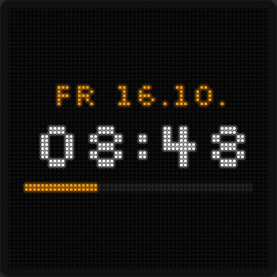{w=176}

| **Einstellung** | **Bedeutung** |
|---|---|
| **Uhr** | *Digital* (Ziffern, Datum, Sekundenbalken) oder *Analog* (Zifferblatt mit Zeigern) |
| **Datum anzeigen** | Wochentag und Datum (digital) / unter dem Zifferblatt (analog) |
| **Sekunden anzeigen** | 20:31:05 statt 20:31 |
| **Sekundenbalken** | dünner Balken, der sich jede Minute füllt |
| **Sekundenzeiger** *(analog)* | dünner Zeiger in der Akzentfarbe |
| **Ring** *(analog)* | dezenter Kreis ums Zifferblatt |

Die Uhrzeit kommt von Home Assistant; ist HA nicht erreichbar, holt sich das Panel die Zeit aus dem Internet (SNTP). Zeitzone und 24-/12-Stunden-Format unter *Einstellungen → Allgemein*.

## Wetter

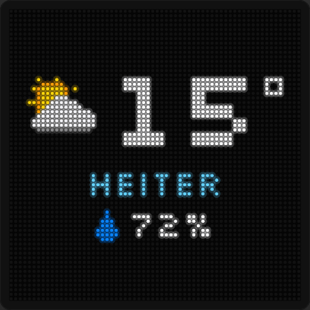{w=176}

| **Einstellung** | **Bedeutung** |
|---|---|
| **Entität** | eine `weather.…` -Entität (Zustand + Temperatur + Luftfeuchte) |
| **Luftfeuchtigkeit anzeigen** | Tropfen + Prozent unter dem Wetter |

Das Symbol (Sonne, Wolken, Regen, Schnee, Gewitter, Wind …) und der Text („HEITER“, „REGEN“ …) kommen aus dem Zustand.

## Wert

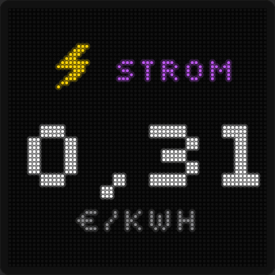{w=176}

Ein großer Wert – z. B. Strompreis, PV-Leistung, Kurs, Raumtemperatur.

| **Einstellung** | **Bedeutung** |
|---|---|
| **Entität** | jede Entität mit Zahlenwert (Text geht auch) |
| **Angezeigter Wert** | Zustand oder ein Attribut der Entität |
| **Titel auf dem Panel** | kurzes Wort über dem Wert, z. B. STROM |
| **Icon** | kleines Bild neben dem Titel ([Kapitel 9](#kap-9)) |
| **Icon animieren** | nur bei Icons, die sich bewegen können – siehe [Animierte Icons](#animierte-icons) |
| **Einheit** | leer = Einheit aus Home Assistant |
| **Nachkommastellen** | Automatisch, 0–3 |
| **Tausenderpunkte** | 1.234 statt 1234 |
| **Zweite Zeile** | eine zweite Entität klein darunter, optional **als Trend eingefärbt** (grün steigt / rot fällt) |

Kein Zahlenwert? Dann wird der Zustand als Text gezeigt (on/off → AN/AUS).

## Entität

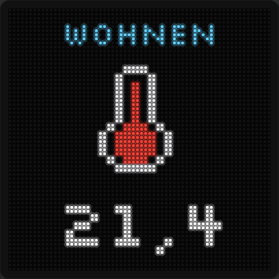{w=176}

Genau eine Entität, groß, mit einem Icon darüber oder darunter.

| **Einstellung** | **Bedeutung** |
|---|---|
| **Entität / Angezeigter Wert** | wie bei *Wert* |
| **Icon** und **Position** | Icon oben oder unten |
| **Icon animieren** | wie bei *Wert* – siehe [Animierte Icons](#animierte-icons) |
| **Titel (optional)**, **Einheit**, **Nachkommastellen** | wie bei *Wert* |

Beispiel Wassertank: Entität = Füllstand in %, Icon = **Füllstand automatisch** – das Icon zeigt je nach Prozentwert leer, halb oder voll.

### Animierte Icons

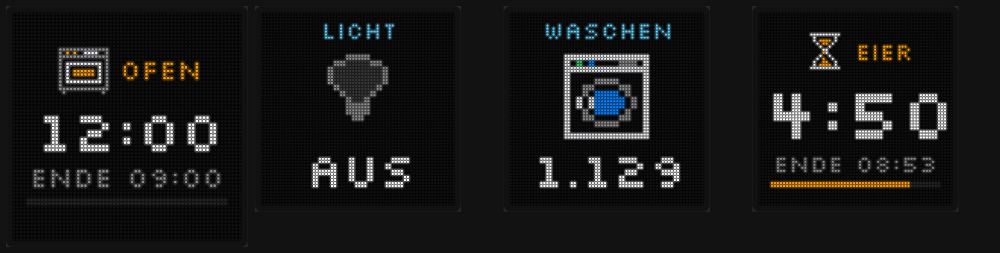{w=176}

Manche Icons können sich bewegen. Schalte dafür unter dem Icon **„Icon animieren“** ein (Wert-, Entitäten- und Timer-Seite, auch im Stapel):

| **Icon** | **an / läuft** | **aus** |
|---|---|---|
| **Glühbirne** | leuchtet gelb, Strahlen pulsieren | grau |
| **Farblicht** | Farben wandern | grau |
| **Waschmaschine**, **Trockner** | Wäsche dreht sich in der Trommel | steht still |
| **Spülmaschine** | Sprühstrahl wechselt | steht still |
| **Ventilator** | Flügel drehen sich | steht still |
| **Sanduhr** | Sand rieselt | steht still |

Was als **„an“** zählt:

| **Einstellung** | **Bedeutung** |
|---|---|
| **Zustand von** | leer = der Wert dieser Seite. Sonst eine eigene Entität, z. B. die Steckdose der Waschmaschine oder ihr Status |
| **Läuft ab** | nur für Zahlen, z. B. Leistung in W: läuft, wenn der Wert **darüber** liegt (z. B. 5). Leer = über 0 |
| **Gerade** | zeigt, ob das Panel das Gerät gerade als „an / läuft“ sieht |

Als „an“ gelten die Zustände `on`, `open`, `playing`, `running`, `active`, `washing`, `rinsing`, `spinning`, `drying`, `cleaning`, `heating`, `cooling` (Groß-/Kleinschreibung egal) – oder eine Zahl über der Schwelle. `off`, `unavailable` und alles andere zählen als „aus“.

Auf der **Timer-Seite** gibt es keine Einstellung dafür: Das Icon bewegt sich, solange der Timer läuft, und steht bei Pause und bei „FERTIG“ still.

Das Panel rechnet die Animation selbst – auch ohne PC. Die Strombegrenzung zählt jedes Bild mit.

## Liste

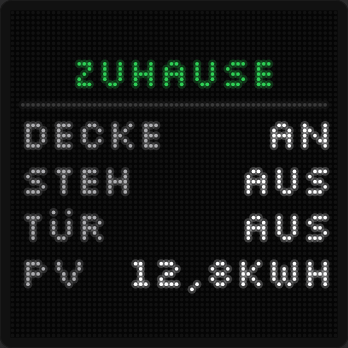{w=176}

Mehrere Entitäten untereinander: links eine kurze Beschriftung, rechts der Wert.

| **Einstellung** | **Bedeutung** |
|---|---|
| **Titel** | Überschrift, z. B. ZUHAUSE |
| **Einträge** | je Zeile Beschriftung + Entität, ＋ **Entität hinzufügen** |

Es passen so viele Einträge, wie die Fläche hergibt – bei großen Flächen in mehreren Spalten. Das Studio zeigt, wie viele gerade passen. Kleinere Schrift = mehr Platz. An/Aus wird zu AN/AUS.

## Timer

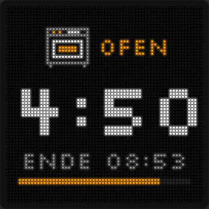{w=176}

Restzeit vom Backofen, der Waschmaschine, dem Trockner oder einem Timer-Helfer. Die Seite erscheint von selbst, sobald der Timer läuft, zeigt Restzeit, „ENDE 12:45“ und einen Fortschrittsbalken, danach ein paar Minuten „FERTIG“ – und verschwindet wieder.

| **Einstellung** | **Bedeutung** |
|---|---|
| **Entität** | Restzeit, Endzeit oder Timer-Helfer |
| **Art des Werts** | *Restzeit* (Zahl oder „1:05:30“ – das Panel zählt selbst sekundengenau herunter), *Endzeit* (Zeitstempel, z. B. „Programmende“ bei Home Connect/Miele), *HA-Timer* (`timer.…`, inkl. Pause) |
| **Einheit der Zahl** | Sekunden, Minuten oder Stunden (nur bei reinen Zahlen) |
| **Status** | wie das Panel den Timer gerade sieht |
| **Beispiel in der Vorschau** | *Läuft* oder *Fertig* – zeigt einen Beispiel-Timer zum Einstellen, wird nicht übertragen |
| **Nur wenn der Timer läuft** | sonst ist die Seite ausgeblendet und stört die Rotation nicht (gilt nur für eigene Timer-Seiten, nicht im Stapel) |
| **Sofort zeigen** | springt beim Start direkt auf diese Seite |
| **„FERTIG“ anzeigen** | nein, 1, 2, 5, 10 oder 30 min nach dem Ablauf |
| **Nur diesen Timer zeigen** | solange er läuft, pausieren alle anderen Seiten |
| **Titel, Icon** | z. B. OFEN mit Backofen-Icon |
| **Icon animieren** | z. B. Sanduhr oder Waschmaschine bewegen sich, solange der Timer läuft |
| **Endzeit anzeigen** | „ENDE 12:45“ unter der Restzeit |
| **Fortschrittsbalken** | füllt sich vom Start bis zum Ende |
| **Rahmen blinkt, wenn fertig** | solange „FERTIG“ angezeigt wird, blinkt ein Rahmen um die Fläche (0,4 s an / 0,4 s aus) |
| **Farbe des Rahmens** | Standard Rot |

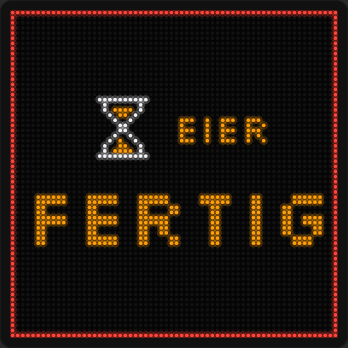{w=176}

Der Rahmen blinkt nur, solange „FERTIG“ zu sehen ist – stell dafür bei **„FERTIG“ anzeigen** eine Dauer ein.

**Wenn mehrere Timer laufen** (bei „Nur diesen Timer zeigen“): nur den kürzesten zeigen oder **abwechselnd** (alle 5–60 s).

Tipp: Zeigt ein Gerät die Restzeit auch im Leerlauf an, zusätzlich eine Bedingung setzen (z. B. Programmstatus = run).

## Laufschrift

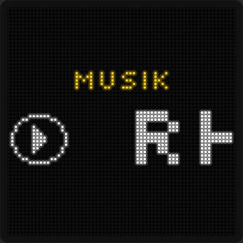{w=176}

Ein Text läuft von rechts nach links.

| **Einstellung** | **Bedeutung** |
|---|---|
| **Quelle** | *Fester Text* oder *Aus Home Assistant* |
| **Text** | dein eigener Text (bis 200 Zeichen) |
| **Entität / Angezeigter Wert** | z. B. Medien-Player mit `media_title` oder `media_artist`, ein `input_text` -Helfer, ein Sensor |
| **Davor (optional)** | Text vor dem Wert, z. B. „♪ “ |
| **Immer laufen lassen** | aus = kurze Texte stehen still |
| **Geschwindigkeit** | Langsam, Normal, Schnell |
| **Durchlauf** | *Mit Pause* (hält am Anfang kurz an) oder *Endlos* (läuft ohne Halt wie ein Nachrichtenticker, zwischen den Durchläufen ein Punkt) |
| **Titel, Icon** | optional über/neben dem Text |

## Kalender

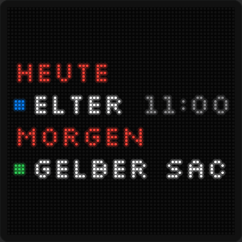{w=176}

Die nächsten Termine aus deinen Kalendern.

| **Einstellung** | **Bedeutung** |
|---|---|
| **Darstellung** | *Liste* (wie im Handy: HEUTE, MORGEN, ab übermorgen z. B. „DO 15.10.“, darunter die Termine mit Punkt in Kalenderfarbe und Uhrzeit) oder *Groß* (wenige Termine groß – „HEUTE 14:30“, „JETZT“, „BIS 20.10.“; zu lange Titel laufen durch) |
| **Termine aus** | *Kalendern* (bis zu 4 Kalender, je der nächste Termin) oder *Helfer-Sensor (Liste)* (bis zu 12 Termine aus mehreren Kalendern) |
| **Kalender** | Kalender + Farbe, ＋ **Kalender hinzufügen** |
| **Termine zeigen** | wie viele höchstens – was nicht passt, lässt das Panel weg |
| **Titel auf dem Panel** | optional |
| **Ausblenden** | Termine mit diesen Wörtern nicht zeigen, z. B. „WKT Frei, Geburtstag“ |
| **Farben** | Titel der Termine; Akzent für Überschrift und Datum |

Doppelte Termine (gleicher Titel am gleichen Tag) erscheinen nur einmal; mehrtägige einmal mit „bis …“ bzw. „-20.10.“. Ganztägige Termine haben keine Uhrzeit.

### Helfer-Sensor einrichten

Ein Kalender in Home Assistant verrät von sich aus nur **den nächsten** Termin. Für eine echte Liste:

1. *Termine aus* → **Helfer-Sensor (Liste)** → **Anleitung & YAML …**
2. Kalender auswählen – sie landen automatisch in der YAML.

3. **YAML kopieren**, in Home Assistant die `configuration.yaml` öffnen (z. B. mit der App „File editor“) und den Text ans Ende einfügen. Steht dort schon `template:`, nur den Teil ab `- triggers:` darunter einfügen.
4. Home Assistant neu starten (oder *Entwicklerwerkzeuge → YAML → Template-Entitäten neu laden*).
5. Im Studio als Sensor **„PixelPanel Termine“** auswählen.

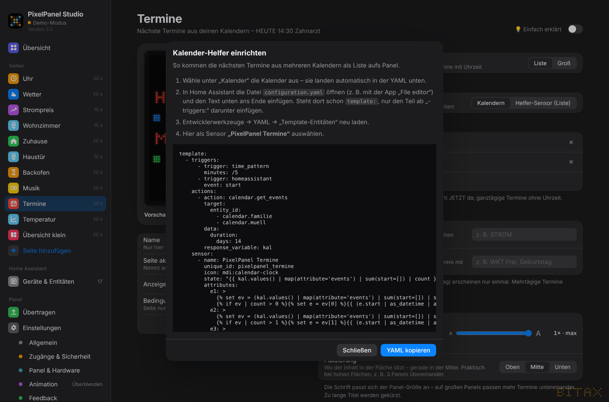{w=499}

## Verlauf

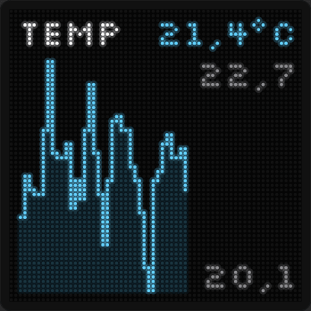{w=176}

Ein Diagramm als Linie oder Balken.

| **Einstellung** | **Bedeutung** |
|---|---|
| **Entität** | ein Zahlenwert, z. B. Temperatur, Verbrauch, Strompreis |
| **Werte** | *Panel zeichnet auf* (das Panel speichert den Verlauf selbst, auch nach Neustart) oder *Liste aus Attribut* (fertige Werte-Reihe, z. B. Strompreis-Prognose von Tibber, Nordpool, EPEX …) |
| **Zeitraum** | 6 h, 24 h, 4 Tage, 7 Tage – 48 Punkte, je Punkt der Mittelwert |
| **Attribut mit Liste / Schlüssel** | bei *Liste*: das Attribut (oft „today“, „forecast“, „prices“) und – falls nötig – welche Zahl gemeint ist („value“, „price“ …) |
| **Art** | Linie oder Balken |
| **Aktueller Wert** | oben rechts der Wert von gerade eben |
| **Min / Max** | höchster und niedrigster Wert rechts am Diagramm |
| **Titel, Einheit, Nachkommastellen, Farben** | wie bei *Wert* |

Nach dem Übertragen beginnt das Panel mit der Aufzeichnung; die Vorschau im Studio zeigt schon vorher den Verlauf aus Home Assistant.

## Stapel

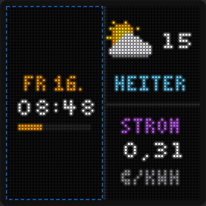{w=176}

Mehrere Inhalte gleichzeitig auf dem Panel.

1. **Aufteilung** wählen: 2/3/4 nebeneinander, 2/3 übereinander, 2 × 2, groß links + 2 rechts, 2 links + groß rechts, groß oben + 2 unten, 2 oben + groß unten; bei mehreren Panels zusätzlich „Je Panel ein Feld“. Ein Stapel braucht Felder von mindestens 32 × 32 Pixel.
2. Oben die **Feld-Reiter** (Feld 1, Feld 2 …) – das gewählte Feld ist in der Vorschau blau umrandet.
3. **Inhalt von Feld …**: Uhr, Wetter, Wert, Entität, Liste, Timer, Laufschrift, Kalender oder Verlauf – oder „Einstellungen kopieren von …“ einer vorhandenen Seite.
4. Darunter die Einstellungen dieses Feldes – genau wie bei der jeweiligen Seite, mit eigener Textgröße und eigenem *Zu langer Text*.
5. **Trennlinien**: dünne Linie zwischen den Feldern.

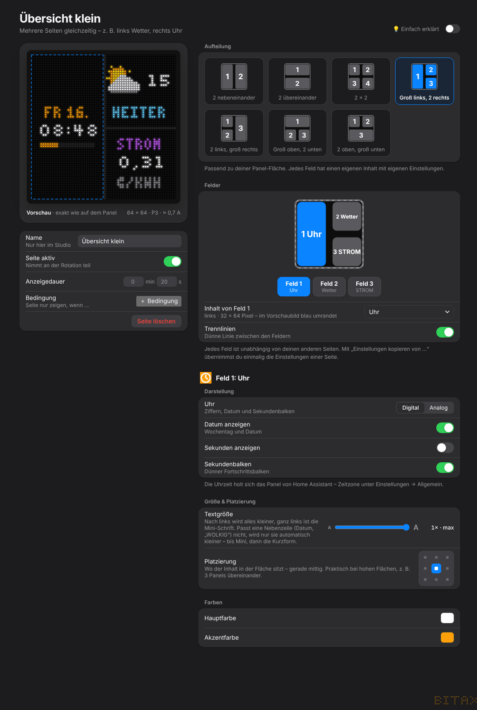{w=380}
