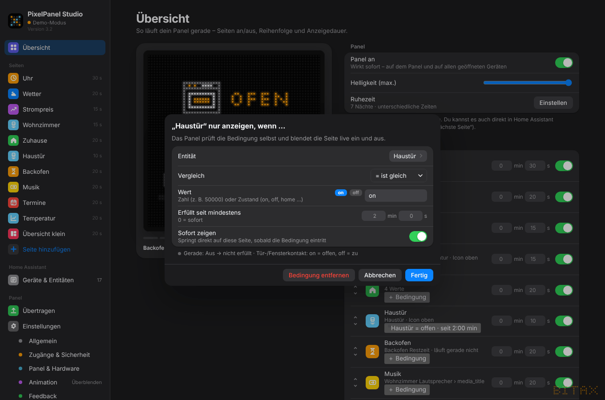

# 5. Bedingungen – Seiten automatisch ein- und ausblenden

Jede Seite kann eine **Bedingung** bekommen: Sie erscheint nur, wenn etwas zutrifft. In der *Übersicht* oder auf der Seite selbst auf ＋ **Bedingung** klicken.

{w=499}

| **Einstellung** | **Bedeutung** |
|---|---|
| **Entität** | jede Entität aus Home Assistant |
| **Vergleich** | größer als, kleiner als, mindestens, höchstens, ist gleich, ist nicht |
| **Wert** | eine Zahl (z. B. 50000) oder ein Zustand (on, off, home …). Für Schalter, Kontakte, Personen usw. gibt es Schnellknöpfe |
| **Erfüllt seit mindestens** | Minuten + Sekunden; 0 = sofort |
| **Sofort zeigen** | springt direkt auf diese Seite, sobald die Bedingung eintritt |

Unten im Dialog steht live, ob die Bedingung **gerade erfüllt** ist.

## Beispiele

- Kurs-Seite nur, wenn `Kurs > 50000`

- Haustür-Seite nur, wenn `Haustür = on` **seit mindestens 2 min**, mit *Sofort zeigen* – dann springt das Panel direkt hin
- Strompreis-Seite nur, wenn `Strompreis ≤ 0,20`
- Begrüßung nur, wenn `person.… = home`

Bei Tür- und Fensterkontakten gilt: **on = offen, off = zu**.

## So funktioniert es

- Das Panel prüft die Bedingungen **selbst und live**. Ändert sich der Wert in Home Assistant, blendet es die Seite sofort ein oder aus – auch wenn der PC aus ist.
- In der Übersicht steht an der Seite die Bedingung (z. B. *Haustür = offen · seit 2:00 min*), in der Rotation ist sie mit `*` markiert.
- Ist gerade keine Seite erfüllt, bleibt das Panel dunkel.
- **Schwellenwerte** (die Zahl) lassen sich **live** ändern, ohne neu zu übertragen – auch in Home Assistant unter *Konfiguration* des Panels (z. B. „Kurs Schwelle“). Eine neue Entität oder einen anderen Vergleich übernimmt das Panel erst nach „Übernehmen & aufs Panel“.
- **Bedingung entfernen** im Dialog löscht sie wieder.
