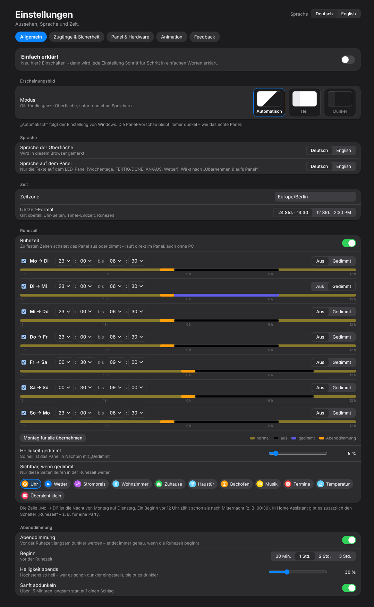

# 6. Ruhezeit & Abenddimmung

*Einstellungen → Allgemein* (oder *Übersicht → Ruhezeit → Einstellen*)

{w=349}

## Ruhezeit

Nachts muss das Panel nicht leuchten. Für **jede Nacht** einzeln:

| **Einstellung** | **Bedeutung** |
|---|---|
| **Ruhezeit** (Schalter) | schaltet die Ruhezeit insgesamt an/aus |
| **Mo → Di …** | die Nacht von Montag auf Dienstag usw., jede mit eigenem Haken |
| **Von / Bis** | z. B. 23:00 bis 06:30. Ein Beginn vor 12 Uhr zählt als nach Mitternacht (z. B. 00:30) |
| **Aus / Gedimmt** | ganz aus oder nur schwach leuchtend |
| **Montag für alle übernehmen** | kopiert die Zeiten von Montag auf alle Nächte |
| **Helligkeit gedimmt** | wie hell das Panel in Nächten mit „Gedimmt“ ist (Prozent) |
| **Sichtbar, wenn gedimmt** | welche Seiten in der gedimmten Ruhezeit weiterlaufen – nachts reicht oft die Uhr |

Der Balken unter jeder Nacht zeigt 12 Uhr mittags bis 12 Uhr am nächsten Tag: normal, Abenddimmung, aus/gedimmt.

## Abenddimmung

Vor der Ruhezeit wird das Panel nach und nach dunkler, damit es abends nicht blendet.

| **Einstellung** | **Bedeutung** |
|---|---|
| **Abenddimmung** | an/aus |
| **Beginn** | 30 Min., 1, 2 oder 3 Std. vor der Ruhezeit |
| **Helligkeit abends** | höchstens so hell (5–90 %) – war es schon dunkler eingestellt, bleibt es dunkler |
| **Sanft abdunkeln** | über 15 Minuten statt auf einmal |

Die Abenddimmung endet immer genau, wenn die Ruhezeit beginnt – Überschneidungen sind ausgeschlossen.

## Gut zu wissen

- Alles läuft **im Panel selbst** – auch ohne PC und ohne Home Assistant.
- In Home Assistant gibt es den Schalter **„Ruhezeit“**, um sie z. B. für eine Party auszusetzen.
- Das **Uhrzeit-Format** (24 h / 12 h) gilt überall: Uhr, Timer-Endzeit, Ruhezeit.
- Änderungen an den Zeiten brauchen einmal **„Übernehmen & aufs Panel“**.
