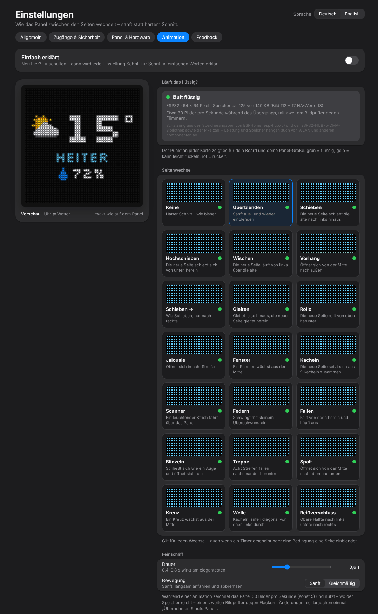
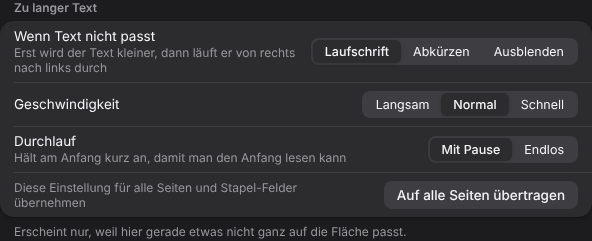
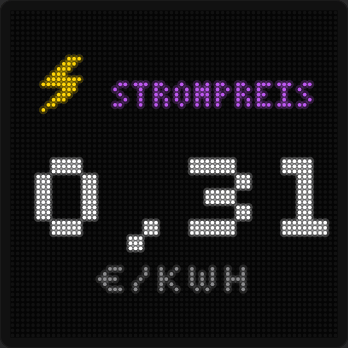

# 7. Animation & Zu langer Text

## Animation – der Seitenwechsel

*Einstellungen → Animation*

{w=349}

Wie das Panel von einer Seite zur nächsten wechselt. 21 Übergänge:

Keine · Überblenden · Schieben · Hochschieben · Wischen · Vorhang · Schieben → · Gleiten · Rollo · Jalousie · Fenster · Kacheln · Scanner · Federn · Fallen · Blinzeln · Treppe · Spalt · Kreuz · Welle · Reißverschluss

| **Einstellung** | **Bedeutung** |
|---|---|
| **Läuft das flüssig?** | Schätzung für dein Board und deine Panel-Größe. Der Punkt an jeder Karte: grün = flüssig, gelb = kann leicht ruckeln, rot = ruckelt |
| **Dauer** | 0,15–2 s; 0,4–0,8 s wirkt am elegantesten |
| **Bewegung** | *Sanft* (langsam anfahren und abbremsen) oder *Gleichmäßig* (gleiche Geschwindigkeit von Anfang bis Ende) |

Die Vorschau zeigt den Wechsel live. Der Übergang gilt für jeden Wechsel – auch wenn ein Timer erscheint oder eine Bedingung eine Seite einblendet.

Während einer Animation zeichnet das Panel 30 Bilder pro Sekunde (sonst 5) und nutzt – wo der Speicher reicht – einen zweiten Bildpuffer gegen Flackern. Bei hoher Last senkt das Studio die Bildrate und, wenn nötig, die Farbtiefe automatisch. Änderungen hier brauchen einmal **„Übernehmen & aufs Panel“**.

## Zu langer Text

Passt auf einer Seite etwas nicht auf die Fläche – ein langer Titel, „WOLKIG“ in einem kleinen Stapel-Feld, ein langer Termin –, erscheint in den Einstellungen dieser Seite der Bereich **„Zu langer Text“**. Passt alles, ist der Bereich gar nicht zu sehen.

{w=444}

| **Einstellung** | **Bedeutung** |
|---|---|
| **Wenn Text nicht passt** | **Laufschrift** – erst wird der Text kleiner, dann läuft er von rechts nach links durch · **Abkürzen** – der Text bleibt stehen und wird am Ende abgeschnitten · **Ausblenden** – Nebenzeilen (z. B. „WOLKIG“, Datum, Titel) fallen weg, Hauptwerte werden abgekürzt |
| **Geschwindigkeit** | Langsam, Normal, Schnell (nur bei Laufschrift) |
| **Durchlauf** | *Mit Pause* – hält am Anfang kurz an, damit man den Anfang lesen kann · *Endlos* – läuft ohne Halt durch, zwischen den Durchläufen ein Punkt |
| **Auf alle Seiten übertragen** | übernimmt diese Wahl für alle Seiten und Stapel-Felder |

Die Einstellung gibt es **pro Seite** und **pro Stapel-Feld**. Hauptwerte (Uhrzeit, Temperatur, Zahl) bleiben immer ganz sichtbar – wird es zu eng, werden zuerst Nebenzeilen kleiner, dann kurz geschrieben, dann weggelassen.

{w=176}
