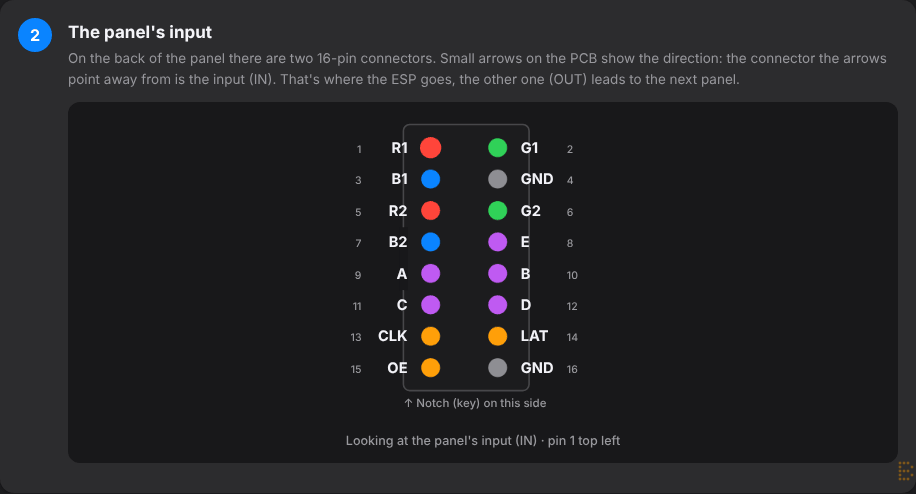
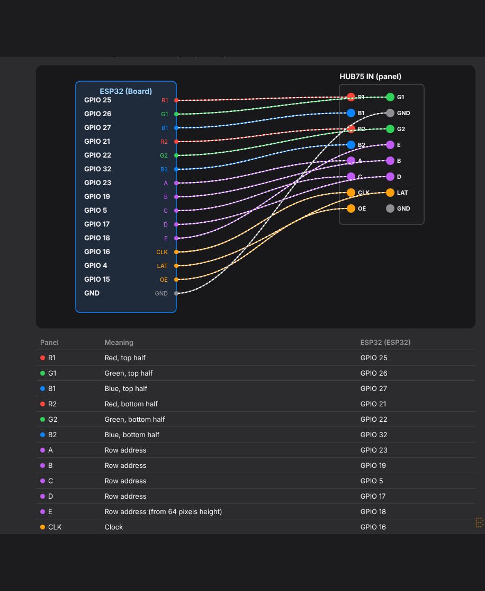
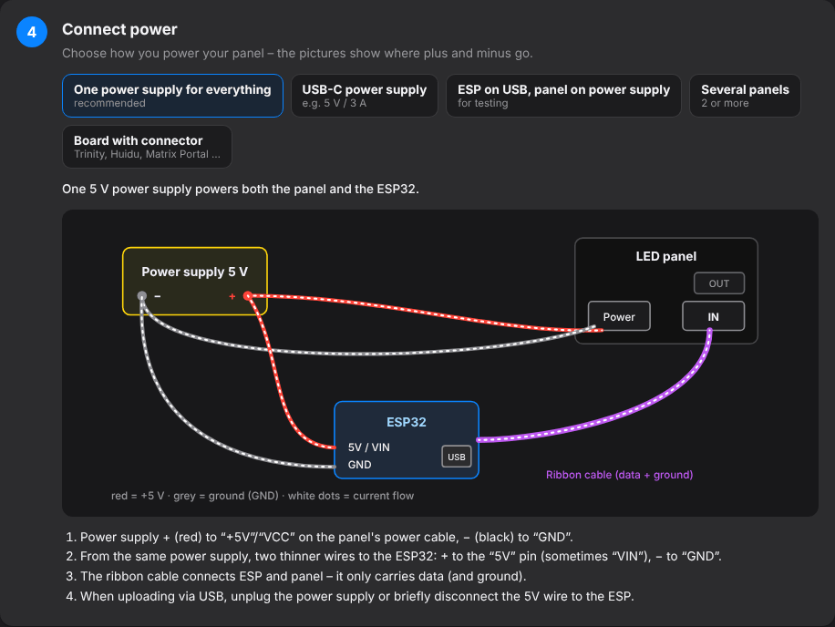
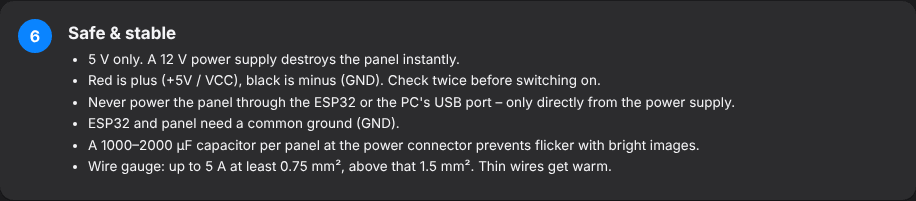

# 2. Hardware & wiring

## What you need

- **LED panel with HUB75 connector** (e.g. 64 × 64 pixels, P2.5 or P3) with ribbon cable and power cable
- **ESP32** – a plain ESP32 DevKit is enough for one or two panels; for large areas (more than 128 × 64 pixels) an **ESP32-S3** is better
- **5 V power supply** – at least 2 A; for full brightness on white images about 4–5 A per 64×64 panel. **Never 12 V or 24 V!**
- **USB data cable** for the very first flash (some charging cables can't carry data)
- For a DevKit: about 15 female–female jumper wires or a HUB75 adapter board
- Optional: a 1000–2000 µF / 10 V+ capacitor per panel at the power connector (against flicker)

## Choose the board

*Settings → Panel & hardware → Hardware*

| **Board** | **Chip** | **Note** |
|---|---|---|
| ESP32 DevKit – ESPHome default | ESP32 | pinout as in the ESPHome example (default) |
| ESP32 DevKit – MatrixPanel-DMA pinout | ESP32 | pinout of the well-known DMA library |
| ESP32 Trinity | ESP32 | ready-made board that plugs straight onto the panel |
| Adafruit Matrix Portal S3 | ESP32-S3 | ready-made board |
| Apollo Automation M1 (Rev. 4 / Rev. 6) | ESP32-S3 | ready-made board |
| Huidu HD-WF1 / HD-WF2 | ESP32-S2 / - S3 | low-cost controller cards |
| ESP32 DevKit / ESP32-S3 DevKitC – custom wiring | ESP32 / -S3 | enter every pin yourself |

Ready-made boards use ESPHome's board presets – pins and chip are set correctly automatically.

**Does the board suit your panel?** Below it the Studio estimates memory and speed (green = runs smoothly, yellow = tight, red = too much) – including all Home Assistant values and your animation.

**Driver chip:** *Standard* fits almost always. If the panel stays dark, shows wrong colours or ghosting, choose **FM6126A** and upload again.

## Wiring step by step

*Panel & hardware → Hardware → Show wiring*** opens an illustrated guide for your board. The key pictures:

### The input on the panel

There are two 16-pin connectors on the back of the panel. Small arrows show the direction: the connector the arrows point **away from** is the **input (IN)**. The ESP32 goes there; the other one (OUT) leads to the next panel.

{w=499}

### Connect ESP32 and panel

Each wire from the ESP32 to the contact with the same name. Tip: plug the supplied ribbon cable into the panel input and the jumper wires into the other end of the ribbon – that way you can't bend anything on the panel.

{w=466}

Default pinout (ESP32 DevKit, ESPHome default):

| **Panel** | **Meaning** | **ESP32** |
|---|---|---|
| R1 / G1 / B1 | red/green/blue upper half | GPIO 25 / 26 / 27 |
| R2 / G2 / B2 | red/green/blue lower half | GPIO 21 / 22 / 32 |
| A / B / C / D | row address | GPIO 23 / 19 / 5 / 17 |
| E | row address (from 64 px height) | GPIO 18 |
| CLK / LAT / OE | clock / latch / output enable | GPIO 16 / 4 / 15 |
| GND | ground | GND |

### Connect power

{w=499}

The guide shows every variant: one power supply for everything (recommended), USB-C power supply, ESP on USB + panel on the power supply, several panels, boards with their own connector.

### Safe & stable

- **5 V only.** A 12 V supply destroys the panel instantly.
- Red is plus (+5 V / VCC), black is minus (GND) – check twice before switching on.
- **Never** power the panel through the ESP32 or the PC's USB port – only directly from the power supply.
- ESP32 and panel need a **common ground** (GND).
- Wire gauge: at least 0.75 mm² up to 5 A, 1.5 mm² above.
- Wire everything first, then switch on. Don't re-plug anything while powered.

{w=499}
