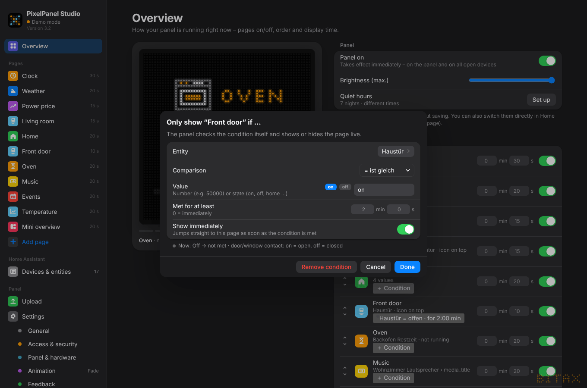

# 5. Conditions – show and hide pages automatically

Every page can have a **condition**: it only appears when something is true. Click ＋ **Condition** on the *Overview* or on the page itself.

{w=499}

| **Setting** | **Meaning** |
|---|---|
| **Entity** | any entity from Home Assistant |
| **Comparison** | greater than, less than, at least, at most, equals, is not |
| **Value** | a number (e.g. 50000) or a state (on, off, home …). Switches, contacts, persons etc. get quick buttons |
| **Met for at least** | minutes + seconds; 0 = immediately |
| **Show immediately** | jumps straight to this page as soon as the condition becomes true |

The dialog shows live whether the condition is **currently met**.

## Examples

- Price page only if `Price > 50000`

- Front-door page only if `Front door = on` **for at least 2 min**, with *Show immediately* – the panel jumps right there
- Electricity price page only if `Price ≤ 0.20`
- Welcome page only if `person.… = home`

For door and window contacts: **on = open, off = closed**.

## How it works

- The panel checks the conditions **itself, live**. When the value changes in Home Assistant, it shows or hides the page immediately – even with the PC switched off.
- The overview shows the condition next to the page; in the rotation it is marked with `*`.
- If no page is currently met, the panel stays dark.
- **Thresholds** (the number) can be changed **live** without a new upload – also in Home Assistant under the panel's *Configuration* (e.g. “Price threshold”). A new entity or a different comparison needs “Apply & upload to panel”.
- **Remove condition** in the dialog deletes it.
