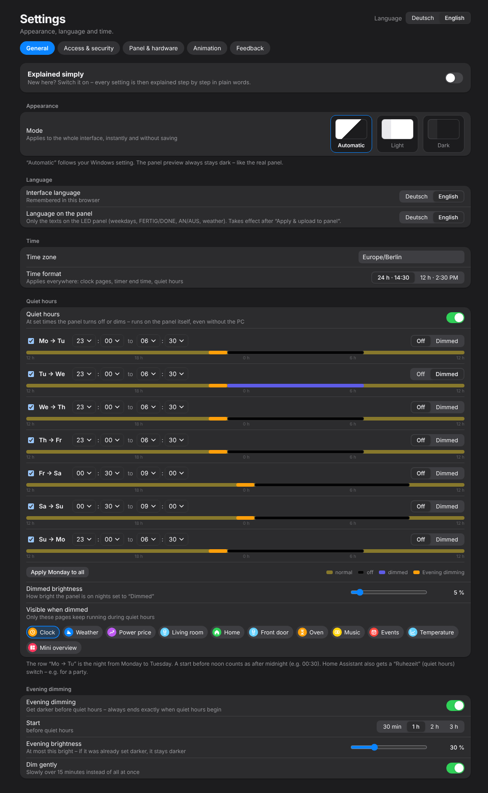

# 6. Quiet hours & evening dimming

*Settings → General* (or *Overview → Quiet hours → Set up*)

{w=349}

## Quiet hours

The panel doesn't need to shine at night. For **each night** separately:

| **Setting** | **Meaning** |
|---|---|
| **Quiet hours** (switch) | turns quiet hours on/off as a whole |
| **Mo → Tu …** | the night from Monday to Tuesday etc., each with its own tick |
| **From / to** | e.g. 23:00 to 06:30. A start before noon counts as after midnight (e.g. 00:30) |
| **Off / Dimmed** | completely off or only faintly lit |
| **Apply Monday to all** | copies Monday's times to every night |
| **Dimmed brightness** | how bright the panel is on “Dimmed” nights (percent) |
| **Visible when dimmed** | which pages keep running during dimmed quiet hours – the clock is often enough at night |

The bar under each night shows noon to noon: normal, evening dimming, off/dimmed.

## Evening dimming

Before quiet hours the panel gets darker step by step so it doesn't dazzle in the evening.

| **Setting** | **Meaning** |
|---|---|
| **Evening dimming** | on/off |
| **Start** | 30 min, 1, 2 or 3 h before quiet hours |
| **Evening brightness** | at most this bright (5–90 %) – if it was already set darker, it stays darker |
| **Dim gently** | over 15 minutes instead of all at once |

Evening dimming always ends exactly when quiet hours begin – overlaps are impossible.

## Good to know

- Everything runs **in the panel itself** – even without PC and Home Assistant.
- Home Assistant gets a switch **“Quiet hours”** to suspend it, e.g. for a party.
- The **time format** (24 h / 12 h) applies everywhere: clock, timer end time, quiet hours.
- Changing times needs **“Apply & upload to panel”** once.
