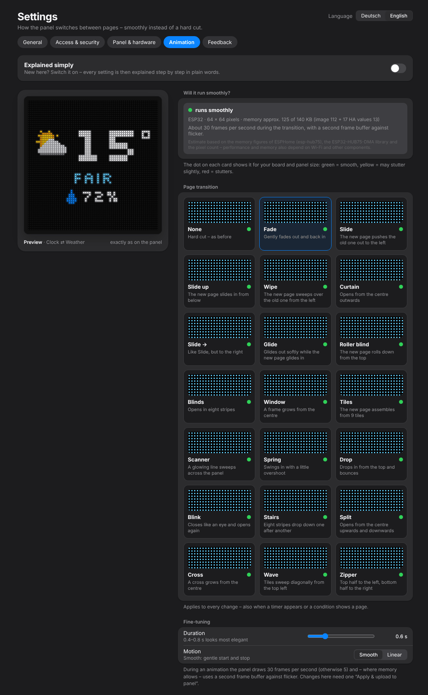
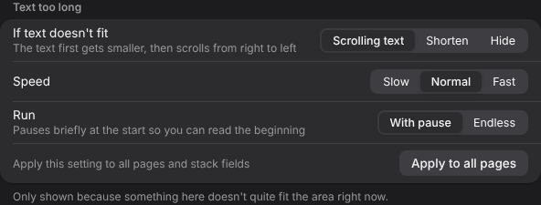
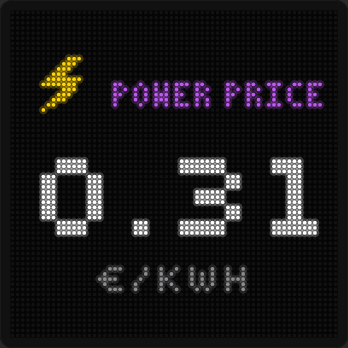

# 7. Animation & text too long

## Animation – the page transition

*Settings → Animation*

{w=349}

How the panel moves from one page to the next. 21 transitions: None, Fade, Slide, Slide up, Wipe, Curtain, Slide →, Glide, Roller blind, Blinds, Window, Tiles, Scanner, Spring, Drop, Blink, Stairs, Split, Cross, Wave, Zipper.

| **Setting** | **Meaning** |
|---|---|
| **Will it run smoothly?** | estimate for your board and panel size. The dot on each card: green = smooth, yellow = may stutter slightly, red = stutters |
| **Duration** | 0.15–2 s; 0.4–0.8 s looks most elegant |
| **Motion** | *Smooth* (eases in and out) or *Linear* (same speed from start to end) |

The preview shows the transition live. It applies to every change – also when a timer appears or a condition shows a page.

During an animation the panel draws 30 frames per second (otherwise 5) and – where memory allows – uses a second frame buffer against flicker. Under high load the Studio lowers frame rate and, if needed, colour depth automatically. Changes here need **“Apply & upload to panel”** once.

## Text too long

If something on a page doesn't fit the area – a long title, “CLOUDY” in a small stack field, a long event – the page settings show the section **“Text too long”**. If everything fits, the section isn't shown at all.

{w=444}

| **Setting** | **Meaning** |
|---|---|
| **If text doesn't fit** | **Scrolling text** – the text first gets smaller, then scrolls from right to left · **Shorten** – the text stands still and is cut at the end · **Hide** – secondary lines (e.g. “CLOUDY”, date, title) are dropped, main values are shortened |
| **Speed** | Slow, Normal, Fast (scrolling only) |
| **Run** | *With pause* – pauses briefly at the start so you can read the beginning · *Endless* – runs without stopping, with a dot between runs |
| **Apply to all pages** | uses this choice for all pages and stack fields |

The setting exists **per page** and **per stack field**. Main values (time, temperature, number) always stay fully visible – when space gets tight, secondary lines first get smaller, then use a short form, then are left out.

{w=176}
