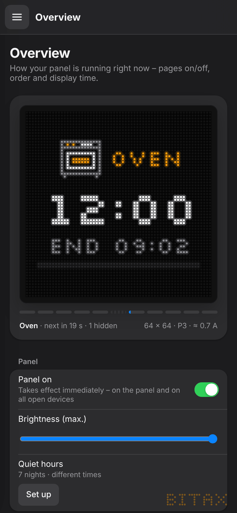
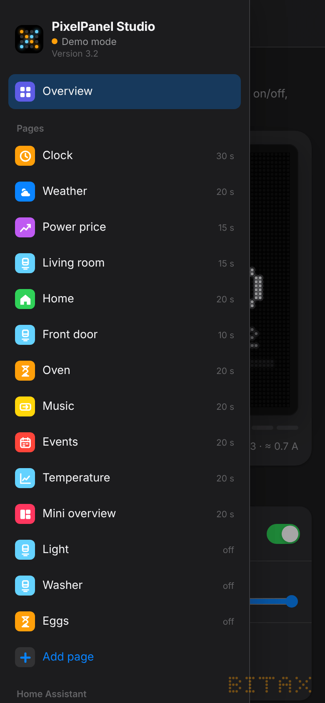
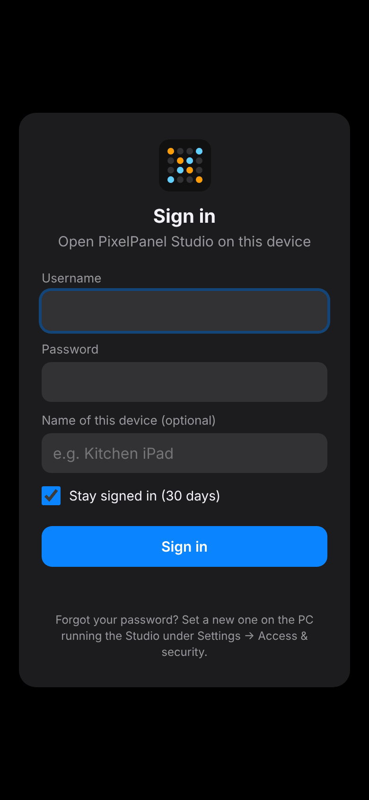

# 8. Phone access & devices

The interface adapts to every screen size: on tablet and phone the sidebar becomes a menu (☰ top left), settings are stacked, dialogs slide up from the bottom.

{w=148} {w=148} {w=148}

## Home Assistant app

Nothing to set up: open Home Assistant on your phone (app or browser) and tap **PixelPanel** in the sidebar. Home Assistant handles the sign-in.

## Sharing the PC version on Wi-Fi

By default the Studio is only reachable on the PC itself. For phones and tablets:

1. On the PC: *Settings → Access & security → Access from phone & tablet*
2. Set a **username** and **password** (at least 8 characters).
3. Turn on **“Share on Wi-Fi”**. The Studio restarts briefly and shows the address (e.g. `http://192.168.178.20:8765`) and a **QR code**.
4. Open the address on the phone or scan the QR code with the camera and sign in.

Tip: in the browser use **“Add to Home Screen”** – then it feels like an app.

Windows may ask about the firewall the first time: allow **“Private networks”**.

### Signing in

- **Stay signed in (30 days)** – on by default. Without the tick the sign-in ends when the browser closes, after 12 hours at the latest.
- **Name of this device (optional)** – e.g. “Kitchen iPad”. Without a name the Studio recognises device and browser itself (e.g. “iPhone · Safari”).

### Signed-in devices

*Access & security → Signed-in devices* lists all phones and tablets: name, last active, how long they stay signed in. **Sign out** ends a single device's sign-in, **Sign out all** ends them all at once.

### Rules

- On the PC itself you **never** need a password.
- Username, password and sharing can only be changed on the PC. Forgot the password? Simply set a new one on the PC – all devices then have to sign in again.
- After 5 failed attempts there is a growing waiting time.
- **Never** forward the port to the internet in your router. On the home network the connection runs without HTTPS – so use a password you don't use anywhere else.

## Several devices at once

All open Studios stay in sync:

- **Brightness** and **Panel on** on the overview take effect immediately – on the panel and on all devices, without saving.
- When one device saves, the others pick up the change automatically.
- If you have unsaved changes yourself on a device, a notice appears at the top: **Reload** or **Keep my changes**.
